{}

 중세를 배경으로 하는 RPG에는 흔히 마법과 용이 등장한다. 검과 갑옷, 성과 기사는 신화와 마법의 규칙 아래 수많은 이야기를 이루며 또 하나의 고전이 됐다. 실제 역사에서 가져온 풍경에 상상력이 거듭 더해지면서, 중세 판타지는 나름의 전통과 익숙한 이미지를 쌓아 왔다. 게임에서 중세를 만나는 경험은 대개 이런 판타지 속에서 이루어진다.

 한편 영화에서는 마법과 용 없는 중세를 그린 작품도 흔히 찾아볼 수 있다. <<브레이브하트>>는 13세기 말 잉글랜드의 지배에 맞선 스코틀랜드의 봉기를 그리고, <<킹덤 오브 헤븐>>은 십자군 시대의 예루살렘을 무대로 삼는다. 역사적 사건을 각색하고 허구의 이야기를 더하면서도, 인물들이 맞서는 갈등은 그 시대의 신앙과 정치, 신분에서 비롯된다. 그 시대적 배경 자체가 작품의 정체성이 되는 것이다. 하지만 게임에서는 이처럼 실제 시대의 조건을 중심에 놓은 작품이 상대적으로 드문 편이다.

 체코의 워호스 스튜디오는 15세기 보헤미아에서 그 무대를 찾았다. 퍼블리셔들은 이 기획을 위험하게 보고 투자를 거절했고, 워호스는 킥스타터 모금으로 이런 게임을 원하는 플레이어가 있다는 것을 먼저 증명해야 했다.[^kcd-kickstarter] 개발진은 실제 지역과 건축물을 조사하고 역사학자의 자문을 받으며 당시의 모습을 재구성했다. 지금도 찾아갈 수 있는 성과 마을을 무대로 삼고, 역사에 기록된 인물들을 등장시켰다.[^kcd-local-history][^kcd-reconstruction] 그곳을 살아갈 주인공으로는 대장장이의 아들 헨리라는 가상의 인물을 내세웠다. 그렇게 우여곡절 끝에 <<킹덤 컴 딜리버런스>>(Kingdom Come: Deliverance)가 2018년 세상에 나왔다.

 출시 뒤의 반응은 엇갈렸다. 이야기와 인물, 충실히 재현한 역사적 배경에 대한 호평이 있었지만, 수많은 버그와 저장 방식, 익히기 어려운 전투는 비판의 대상이 됐다.

 워호스의 다음 작품이 나오기까지는 다시 7년이 걸렸다. 2025년 출시된 <<킹덤 컴 딜리버런스 2>>(Kingdom Come: Deliverance II)는 전작의 결말에서 헨리의 이야기를 이어 간다. 첫 작품에서 시작한 복수와 귀족들의 다툼도 아직 끝나지 않은 상태다. 역사 속 보헤미아를 RPG로 옮기겠다던 스튜디오의 두 번째 작품에서, 헨리는 남은 일들을 마저 해결하러 나서게 된다.

{}이 글에는 메인 스토리와 엔딩의 내용이 포함되어 있다.{}

## 스토리

> 헨리가 되어 복수, 배신, 발견으로 가득한 흥미진진한 이야기를 경험하게 됩니다. '미천한 대장장이의 대장간을 떠나 국왕의 궁정으로 향하는' 환상적인 여정에 올라 아름다우면서도 잔혹한 중세 세계에서 목적을 찾아 나서 보세요.[^official-story]

### 헨리의 연대기

 헨리는 한적한 시골 마을 스칼리츠에서 대장장이인 아버지의 일을 도우며 살던 평범한 청년이었다. 그러던 어느 날 마을이 습격당하면서 부모를 잃고, 아버지와 함께 만든 검마저 빼앗기며 일상이 무너졌다. 부모의 원수를 갚고 검을 되찾겠다고 다짐한 헨리는 라드직 경을 섬기며 싸우는 법을 배우고, 도적들을 추적한다. 그들의 행방과 배후를 쫓던 일은 귀족들 사이의 다툼으로 이어지고, 헨리는 자신이 잃은 것들을 되찾으려다 더 큰 싸움에 휘말리게 된다.

 스칼리츠를 덮친 비극도 그 싸움의 일부였다. 헝가리 국왕 지기스문트는 이복형인 보헤미아 국왕 벤체슬라스(바츨라프 4세)를 감금하고 보헤미아를 장악하려 했고, 왕을 지지하는 귀족들은 이에 맞서고 있었다. 헨리가 섬기는 라드직 경도 왕의 편에 서 있었으며, 그의 영지인 스칼리츠를 습격한 군대 역시 지기스문트가 보낸 것이었다. 1편에서 헨리는 자신에게서 검을 빼앗았던 런트를 쓰러뜨리지만, 검은 이미 이스트반 토트의 손에 넘어가 있었다. 부모의 원수도 아직 갚지 못한 채, 2편은 그가 한스 케이폰의 종자로 베르고프 경에게 서한을 전하러 가는 데서 시작한다.

 하지만 도중에 습격을 받아 빈털터리가 된 일행은 간신히 트로스키 성에 도착하고도, 추레한 행색 때문에 들어가지 못한다. 엎친 데 덮친 격으로 한스와는 다툰 끝에 헤어지기까지 한다. 헨리는 우선 옷을 구하고 일거리를 찾기로 한다. 어떻게든 성으로 들어가 베르고프 경에게 서한을 전해야 하기 때문이다.

 그 길에서 만나는 사람들 중에는 실존 인물이 여럿 등장한다. 헨리와 함께 길을 나선 한스 케이폰과 그가 섬기는 라드직 경, 서한을 전해야 하는 베르고프 경부터 실제 보헤미아에 살았던 사람들이다. 모라비아 변경백 요프스트와 리히텐슈타인 경, 보헤미아 왕위를 노리는 헝가리 국왕 지기스문트와 그의 지휘관 마크바트 폰 아울리츠 등 당대의 유력 인사들은 물론, 훗날 후스 전쟁에서 활약하는 얀 지슈카와 ‘마른 악마’ 히네크, 왕실 조폐 책임자 울리히 바바크와 수흐돌의 영주 피세크 경까지 그 면면도 다양하다. 귀족에게 인정받으려 애쓰던 대장장이의 아들은 이들과 얽히며 점점 더 큰 사건에 관여한다. 여러 실존 인물 사이에 헨리의 이야기가 자연스럽게 어우러지면서, 그의 모험도 실제로 있었던 일처럼 생동감 있게 다가온다.

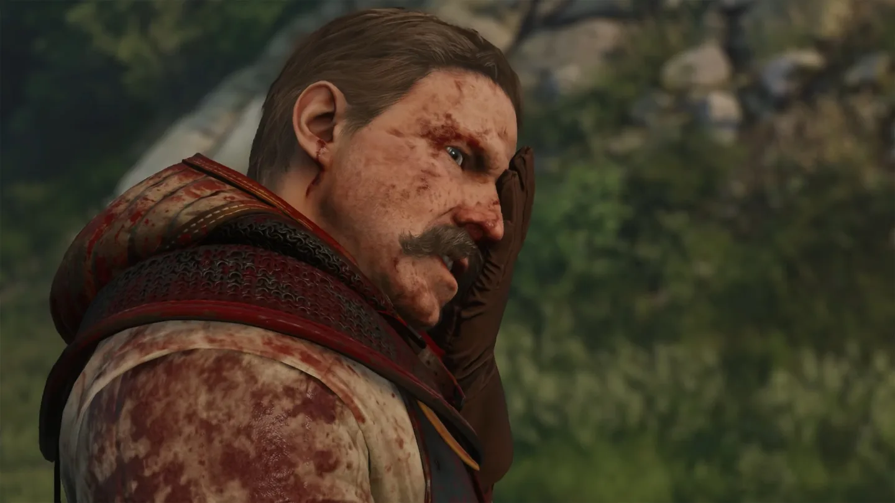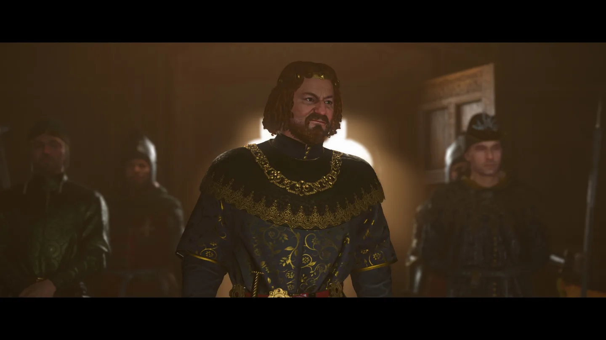

### 꼬리에 꼬리를 무는 이야기

 트로스키 성에서 문전박대당한 헨리는 세민 영주의 아들이 곧 결혼하며, 그 결혼식에 베르고프 경도 참석할 예정이라는 소식을 듣는다. 성에서는 만나지 못했던 그에게 서한을 전할 기회지만, 초대받지 않은 헨리가 잔치에 들어갈 방법부터 찾아야 한다. 그러던 중 결혼식에 데려가 줄 수 있다는 대장장이 라도반과 방앗간지기 크레이즐을 소개받고, 이들의 일을 돕게 된다.

 두 사람이 헨리를 데려가는 방법은 서로 다르다. 라도반은 신랑에게 결혼 선물로 줄 검을 준비하고 있어, 재료를 구하고 검을 만드는 일을 도우면 그의 조수로 잔치에 동행할 수 있다. 반면 크레이즐은 에넬레인을 귀부인처럼 꾸며 시종장을 유혹할 계획을 세운다. 헨리는 그녀가 입을 드레스와 향수를 마련한 뒤, 호위 역할을 맡아 결혼식에 참석한다. 두 사람의 일을 모두 도울 수는 있지만, 마지막에 누구와 어떤 역할로 결혼식에 들어갈지는 하나를 골라야 한다.

 결혼식에 들어가는 방식이 다른 만큼, 그에 앞서 두 사람의 일을 돕는 과정도 분위기가 퍽 다르다. 라도반의 일을 도울 때는 세민 영주와 함께 사라진 짐마차를 추적하고 도적들과 싸우며, 귀족과 병사들 사이에서 움직인다. 반면 크레이즐을 따라가면 관청에 숨어들어 문서를 훔치는 등, 남의 눈을 피하고 수상한 계획에 가담하는 일이 많아진다.

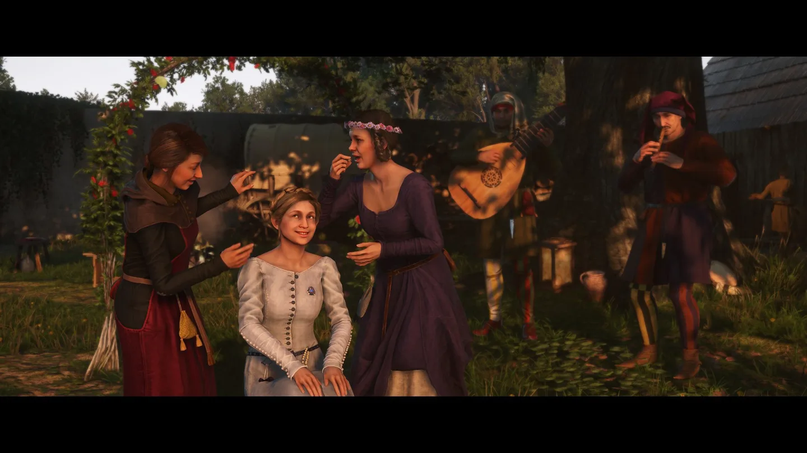

 헨리는 베르고프 경을 만나려고 이들의 일을 돕지만, 라도반과 크레이즐에게는 저마다 따로 하려는 일이 있다. 라도반은 결혼 선물로 줄 검을 준비하고, 크레이즐은 자신의 연금술 계획을 진행하려 한다. 그 부탁을 따라가다 만나는 은둔자와 묘지기에게도 각자의 사정이 있다. 결혼식에 가려다 엮인 사람들이지만, 막상 그들의 일에 발을 들이면 헨리의 서한과는 별개로 이야기가 흘러가는 것이다.

 하나의 큰 목표를 작은 목표들로 나누더라도, 그저 처음의 일을 끝내기 위한 절차가 길어질 뿐이라면 금세 지루해질 것이다. 그런데 처음에 주어진 목표와는 별개의 이야기가 꼬리에 꼬리를 물고 이어진다. 결혼식에 가려면 조수가 되어야 하고, 조수가 되기 위해서는 재료들을 모아야 한다. 재료를 모으기 위해서는 이 지역 사람들의 일을 도와야 하고, 그러다 보면 또 그들이 겪는 새로운 사건에 휘말리게 된다. 그렇게 한참 곁길을 돌아도 궁극적인 목표가 사라지지 않았으니, 처음에 왜 이들을 찾아왔는지는 잊지 않게 된다. 결혼식에 가는 일을 미뤄 두고 주변의 일들을 더 해 보고 싶었던 것도, 1막의 구성이 특히 좋다고 느꼈던 것도 이 때문이었다.

 2막에서는 이러한 연계 구성이 조금 약화된 인상을 받았다. 2막의 지역이 1막보다 훨씬 넓게 펼쳐져 있지만, 각 마을과 쿠텐버그에서 겪는 이야기들은 비교적 독립적으로 구성되어 있었고, 1막에서 느꼈던 유기적인 연계는 덜 인상적으로 다가왔다.

### 복수 끝에 돌아오는 질문

 1편의 메인 스토리를 요약하면 헨리가 복수를 위해 힘을 길러 가는 이야기라고 할 수 있다. 2편의 메인 스토리를 같은 식으로 요약하자면, 그 **복수라는 것이 과연 정당한지, 그리고 그 목적을 이루기 위해 어디까지 허용되는지 묻는 이야기**라 할 수 있다.

 1막의 끄트머리에서 헨리는 부모님의 원수, 이스트반 토트를 마주한다. 그는 자신도 부모를 잃고 복수심을 품고 살아왔다고 말한다. 그러면서 복수를 이룬 다음에는 무엇을 할 것이냐고 반문하며, 더 강한 편에 붙어 승리하는 것이 옳다고 주장한다. 그는 복수를 좇는 헨리가 이전의 자신과 닮았다며, 결국 헨리도 자신이 옳았음을 알게 될 것이라고 역설한다. 플레이어는 그를 비겁하게 기습할 수도, 정정당당하게 결투할 수도 있다. 어떤 선택을 하든 그를 죽이게 되지만, 그의 환영은 이후에도 꿈속에 나타나 헨리를 조롱한다.

 이스트반을 제거했지만, 또 다른 부모님의 원수인 마크바트 폰 아울리츠가 남아 있다. 지기스문트의 심복인 그를 향한 복수는, 지기스문트 세력과 맞서는 전쟁과도 얽히게 된다. 헨리와 지슈카 일행은 지기스문트파 영주를 사로잡기 위해 그가 숨어 있는 말레쇼프로 향한다.

 요새를 공격할 방법을 두고 '마른 악마'는 마을을 불태워 요새의 수비 병력을 끌어내면 아군의 희생을 줄일 수 있다고 주장한다. 헨리는 주민들을 희생하고 아군의 위험을 줄일지, 더 어려운 잠입을 감수하고 주민들을 살릴지 선택해야 한다.

 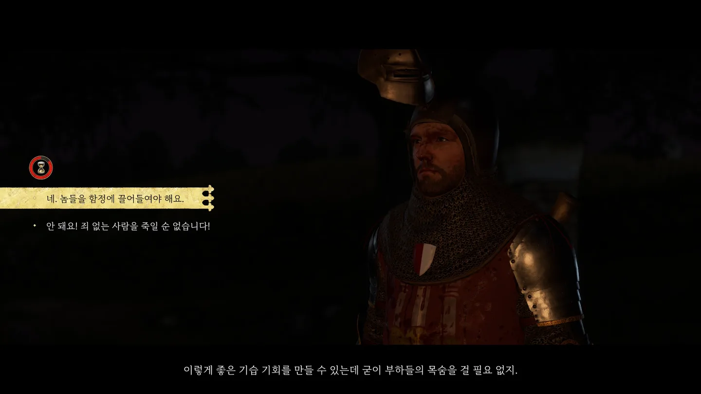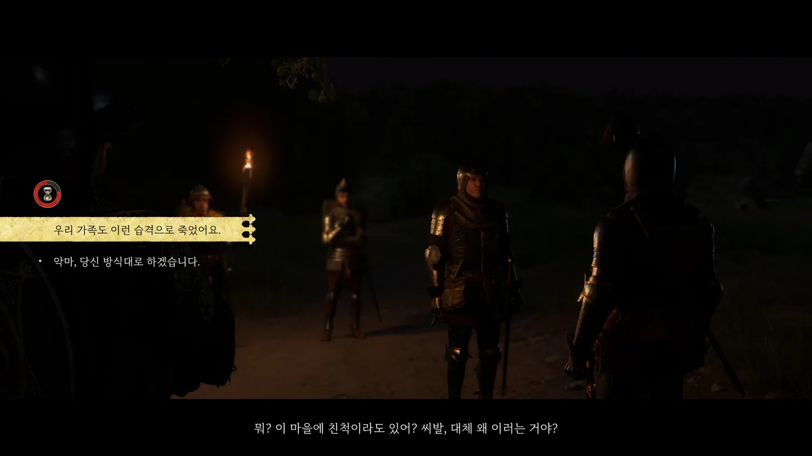

 이 선택에 따라 요새를 공략하는 과정이 달라진다. 그러나 그 선택과 무관하게, 헨리는 악몽 속에서 다시 이스트반을 만난다. 주민을 살리면 꿈속의 이스트반은 자기 손을 더럽히지 않으려고 동료들을 희생했다고 비꼬고, 마을을 불태우면 이제 자신과 같아졌다며 반긴다. 어느 쪽이든 희생된 사람들의 모습이 헨리를 괴롭힌다.

 이 이야기의 대단원에서, 헨리는 홀로 지기스문트군 야영지에 잠입하여 마크바트 폰 아울리츠를 마주한다. 하지만 이미 아울리츠는 중상을 입고 죽음을 기다리고 있다. 그는 부모의 원수를 갚으러 온 헨리에게 자신도 신념을 위해 해야 할 일을 했다고 주장하며 되묻는다.

 > 네가 죽인 이들 중에 누군가의 아버지가 하나도 없었을까?

 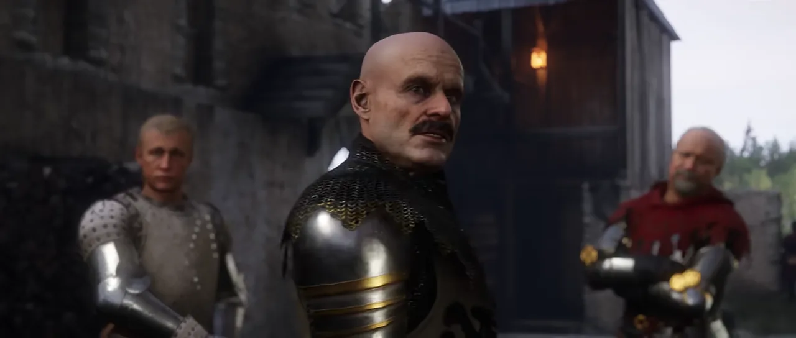

 그러면서도 그는 헨리에게 사죄하고, 자신이 죽인 이들을 기억한다고 말한다. 수많은 병사와 도적을 죽여 온 플레이어라면 뜨끔할 수도 있는 대목이다. 헨리를 조작해 다른 누군가의 가족을 죽여 온 것 역시 플레이어이기 때문이다.

 헨리는 아울리츠의 요청대로 일으켜 세운 뒤 죽일 수도 있고, 앉아 있는 그를 잔혹하게 죽일 수도 있으며, 손을 대지 않고 떠날 수도 있다. 이 셋 중 어느 선택을 하더라도 이후의 플레이는 달라지지 않는다. 그렇다면 이 선택의 의미는 플레이어 각자의 해석에서 찾아야 한다.

 같은 처형도 죗값을 치르게 하는 일로 받아들일 수도, 복수심을 채우는 일로 받아들일 수도 있다. 손을 대지 않고 떠나는 것 역시 자비일 수 있고, 홀로 고통스럽게 죽도록 내버려 두는 일일 수도 있다. 그 행동에 어떤 의미를 부여하는지는 지금까지 헨리를 어떻게 움직여 왔고, 그 행동을 어떤 이유로 납득해 왔는지에 달려 있다. 이 대면은 마지막 선택을 통해 그동안의 플레이를 스스로 어떻게 받아들이는지 되묻는 장면으로 읽힌다.

 모든 전투가 끝나고, 헨리는 꿈속에서 부모와 재회한다. 아버지는 헨리에게 이제 행복해졌느냐고 묻는다. 헨리는 승리를 기뻐할 수도, 그동안 겪은 고통 때문에 행복할 수 없다고 답할 수도 있다. 부모와의 대화는 그렇게 헨리의 마음을 묻는 데서 시작해, 그가 겪어 온 일과 그 과정에서 내린 선택으로 이어진다.

 아버지는 이스트반을 죽였다는 사실보다 그를 어떻게 상대했는지에 주목한다. 정정당당한 대결은 그가 자초한 일로 인정하지만, 잔혹한 처치는 지나쳤다고 말한다. 아울리츠를 직접 죽였다면 그가 벌을 받아 마땅했다는 점을 인정하면서 지나친 분노와 복수심을 걱정한다. 반면 어머니는 복수를 끝까지 완수할 줄 알았다며 아버지의 자비에 반대하기도 한다.

 말레쇼프의 주민을 살렸다면 아버지는 희생이 쉬웠는데도 죄 없는 이들을 구했다고 칭찬한다. 반대로 주민을 희생했다면 어느 곳에서 무고한 사람을 죽였는지 지목하며 질책한다. 헨리는 그 선택을 잘못이었다고 인정할 수도, 동료들을 살리기 위해 필요했다고 주장할 수도 있다. 주민을 살린 경우에도 자신의 동료들이 죽었다며 후회할 수도 있다.

 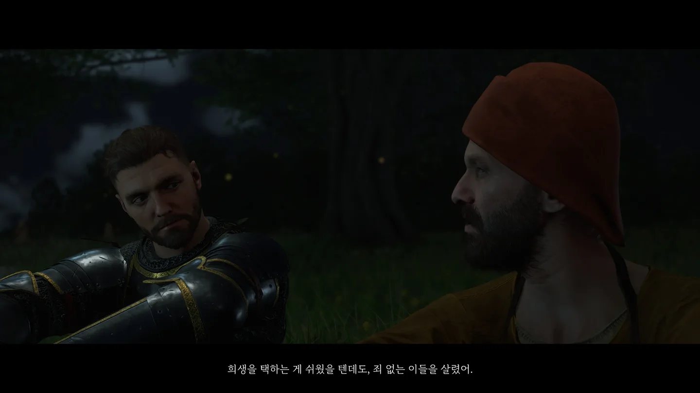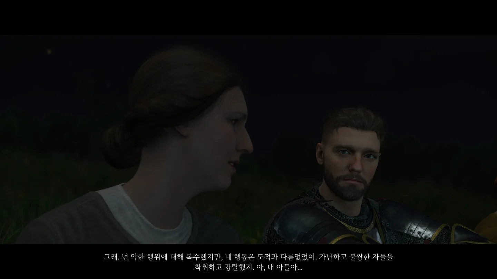

 대화는 주요 사건에서의 선택을 넘어 평소의 행동으로도 이어진다. 어머니는 물건을 많이 훔치거나 민간인을 죽인 일을 질책하며, 범죄를 자제하거나 속죄하려 노력한 점을 인정한다. 헨리는 자신의 행동을 후회하거나 정당화하는 답을 할 수 있다.

 메인 스토리의 주요 분기에서 내린 결정뿐 아니라 평소 게임을 즐기며 해 온 행동과 습관까지 돌아보게 하며, 플레이어가 자신의 행동을 어떻게 생각하는지 직접 답하게 하는 것이다.

### 플레이와 이야기 사이

 부모와의 마지막 대화는 헨리가 누구를 살리고 죽였으며, 그 선택을 스스로 어떻게 생각하는지 묻는다. 플레이어가 해 온 행동을 지목하고 그 의미를 되묻는다는 점에서 <<스펙 옵스: 더 라인>>(Spec Ops: The Line)이나 <<라스트 오브 어스 파트 2>>(The Last of Us Part II)를 떠올리게 한다. 결말에서 이런 질문을 받으며 앞선 행동을 새롭게 바라볼 수도 있다. 다만 그 효과를 살피려면, **플레이어가 실제로 무엇을 선택할 수 있었고 그 행동을 어떤 경험으로 받아들여 왔는지**도 함께 생각해야 한다.

 그런 점에서 킹덤컴 2의 질문에는 납득할 만한 바탕이 있다. 마주하는 모든 적들을 죽여야만 진행이 가능한 것은 아니며, 말레쇼프에서는 주민을 살리기 위해 더 어려운 공략을 감수할 수 있다. 이에 대한 부모의 평가도 플레이어가 내린 선택에 따라 달라진다.

 그러나 선택할 여지가 있었다는 것만으로 이 질문이 충분히 와닿았던 것은 아니다. 메인 스토리에서 복수를 좇는 동안에도 풍부한 서브 스토리를 통해 모험을 즐긴 시간이 길었다. 베르고프 경을 만나기 위해 시작한 일이 라도반과 크레이즐을 돕다가 만난 사람들 각자의 이야기로 이어졌듯, 헨리의 목적을 따라가다가도 다른 사람들의 사정에 관심을 갖게 되었다. 처음의 목표를 잊지는 않았지만, 그 일을 미뤄 두고 주변의 이야기를 더 찾아다니기도 했다. 그 과정에서 관심을 기울였던 것은 헨리의 복수뿐 아니라, 그와는 다른 목적과 사정을 가진 사람들의 삶이었다.

 부모와의 대화는 주요 사건의 선택뿐 아니라 평소의 행동까지 돌아보게 한다. '게임'이기 때문에 해도 된다고 여겼던 절도나 살인에 대한 책임을 묻는 것이다. 물론 범죄에는 처벌과 평판 하락이라는 대가가 따른다. 하지만 그 대가를 발각될 위험과 얻을 이익을 따지는 규칙으로 받아들인다면, 범죄 역시 게임이 제공하는 활동 중 하나로 여길 수 있다. **처벌을 피하도록 만드는 것과 자신의 행동을 윤리적으로 돌아보게 하는 것 사이에는 거리가 있다.**

")

 주요 이야기의 분기점에서는 그런 윤리적 책임에 대한 질문을 의식할 수 있었다. 하지만 전반적인 모험에서 그러한 책임에 대한 무게를 체감할 수 있게 하는 이야기는 적었고, 그렇기 때문에 결말에서 부모의 질책은 다소 당혹스럽게 느껴졌다.

 헨리의 큰 목표에서 출발해, 서로 다른 목적을 가진 인물들의 이야기를 독립적으로 진행하게 하는 서브 스토리의 구성은 훌륭했다. 다만 그 구성이 만들어 낸 모험의 즐거움은, 그동안의 행동을 복수와 희생이라는 관점에서 돌아보게 하려는 메인 스토리의 질문과는 거리가 있었다.

## 현실을 옮긴 시스템

킹덤컴 2의 여러 시스템에서는 중세의 삶을 직접 **체험**하게 하려는 의도가 뚜렷하게 드러난다. 현실의 행동과 절차를 플레이로 옮겨 플레이어가 직접 수행하게 하는 일관적인 설계 때문이다. 하지만 이 과정은 현실에서처럼 손이 가고 시간이 든다. 이렇게 들이는 수고가 헨리의 삶을 더 실감 나게 하고 게임을 더 재미있게 만들기도 하지만, 지루하고 번거로운 일로만 남기도 한다.

### 직접 하는 일의 재미와 수고

 필드에서 얻은 재료로 회복이나 능력 강화에 쓰는 약을 만들거나, 적을 상대할 독을 만드는 시스템은 제법 흔하다. 대개 만들 결과물을 선택하고, 필요한 재료를 갖추고 있다면 그 결과물을 얻을 수 있는 식이다. 킹덤컴 2에서도 이런 약이나 독을 만들 수 있는 시스템인 연금술이 존재한다. 하지만 이 게임의 연금술은 좀 더 특별하다.

 이 게임에서는 어떤 재료를 어느 순서로 넣고, 어떤 방법으로 얼마나 가공했느냐에 따라 완성되는 약이 달라진다. 레시피북을 펼치고, 순서대로 재료를 가공하고, 솥에 넣고 정해진 시간만큼 끓이고, 그대로 따라내거나 증류하는 이 과정 전체를 **직접** 조작해야 한다.

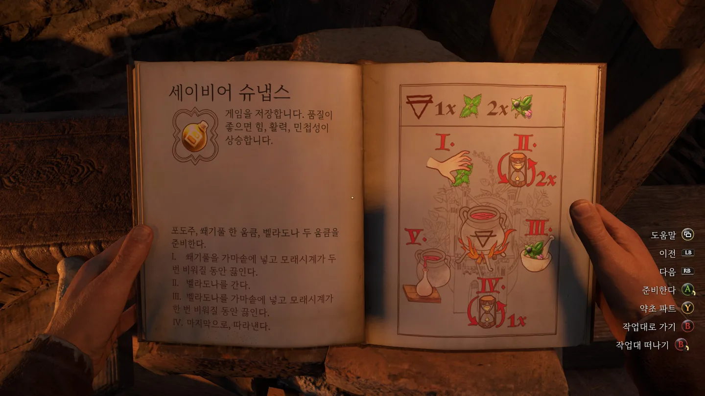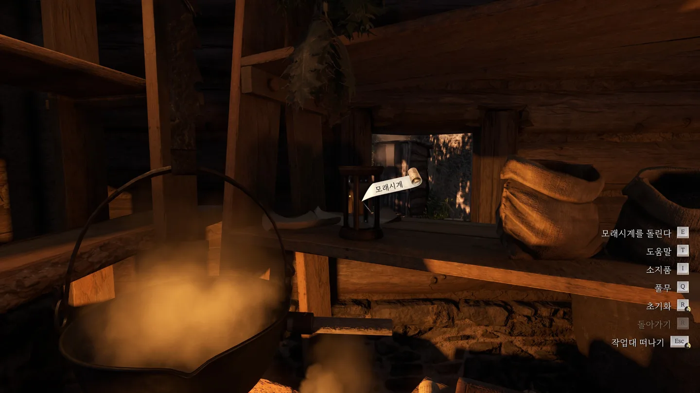

 만약 재료를 잘못 넣거나, 가공을 덜 했거나, 순서를 빼먹었다면 보다 낮은 품질의 결과물을 얻게 된다. 혹은 아예 다른 물건이 나오기도 한다. 이를 뒤집어 생각하면, 레시피를 모르는 약도 직접 만들어 낼 수 있다는 뜻이다.

 재료와 가공 절차에 따른 제작 과정은, 그 레시피가 현실 세계의 그것과 동일한 것인가와는 별개로, 현실에서 무언가를 만드는 방식과 닮아 있어 게임에의 몰입을 돕는다. 또한 이에 그치지 않고 레시피에서 벗어나는 시도를 허용하므로 새로운 조리법을 발견하는 과정 역시 현실과 유사한 점이다. 이러한 점들 덕분에 연금술은 정해진 조작을 수행하는 미니 게임을 넘어, 직접 약을 만들고 조리법까지 발견해 가는 시뮬레이션처럼 받아들여진다.

 다만 같은 과정을 매번 반복하다 보면 처음에는 재미있었던 과정도 점점 귀찮게 느껴진다. 이때 부담을 덜어주는 것이 연금술 퍽이다. 상점에서 구하는 것보다 좋은 품질의 약을 만들 수 있게 되고, 한 번에 얻는 수량이 늘어나면서 같은 조리를 반복해야 하는 이유를 제공하고, 그 횟수는 줄여 준다.

 무기를 만드는 일 역시 마찬가지다. 헨리는 대장간에서 쇠를 달구고, 모루 위에서 망치로 두드리고, 담금질하는 과정을 수행하며, 이 모든 과정에 플레이어의 조작이 필요하다.

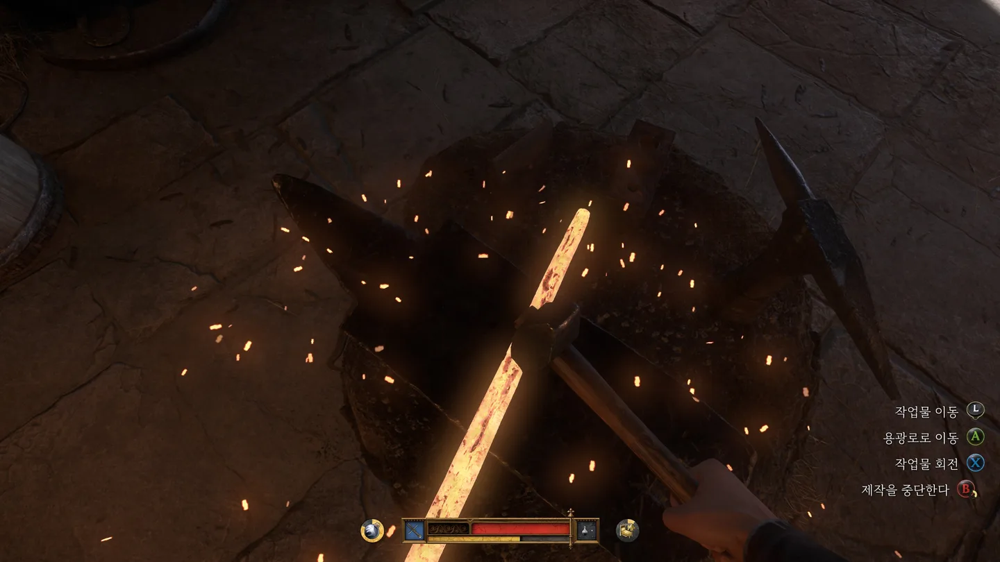

 이 과정에서 또 눈여겨볼 만한 점은 현재 쇠의 온도가 적절한지, 내가 망치질을 잘하고 있는지를 별도의 UI가 아니라 게임 내의 요소로 표현한다는 점이다. 쇠의 온도는 달궈진 쇠의 색상을 통해, 망치질은 쇠의 형태와 헨리의 휘파람을 통해 알려준다. 가끔씩 무언가 안 되고 있다거나, 잘 되고 있다고 말하는 혼잣말은 덤이다.

 이렇게 작업의 상태를 게임 속 사물과 소리로 전달하면, 플레이어는 실제 대장장이처럼 현재 조작하고 있는 대상을 살피며 작업을 이어가게 된다. 이러한 시도는 연금술과 마찬가지로 게임 내 몰입을 돕기 위한 장치라고 볼 수 있다. 자신이 쓸 무기를 마련하는 정도라면 자주 반복할 필요가 없어, 같은 동작의 반복도 크게 부담스럽지는 않다.

 다만 현재 내가 망치를 잘 두드리고 있는지 쉽게 알아볼 수 있었던 것은 아니다. 결과물의 형태는 천천히 변형되고, 정확히 내가 어떤 리듬에 맞추어 어디를 두드려야 하는지 명확하게 보여주지 않기 때문에 감에 의존해야 하는 영역이 있었다. 헨리의 휘파람과 혼잣말은 이를 보조하기 위해 도입된 수단으로 보였지만 충분하다고 느껴지지는 않았다.

 이처럼 현실의 절차를 그대로 플레이로 옮겨온 것은 헨리가 살아가는 방식을 직접 체험하게 한다. 하지만 현실의 절차를 재현한다고 해서 게임적 재미가 항상 생기는 것은 아니다.

 자루를 옮기는 일이 대표적인 예시다. 이 게임에서는 유난히 자루를 옮겨야 하는 일이 많다. 주점에서 음식값을 치를 때도, 방앗간에서 일을 얻을 때도, 성에서 노역할 때도 자루를 옮기게 된다. 자루를 들고 있는 동안에는 다른 행동을 할 수 없으며, 이동 속도도 강제로 느려진다. 이 역시 현실과 같이, 자루를 들고 수레와 창고를 왕복하는 지루한 노동이 되는 것이다.

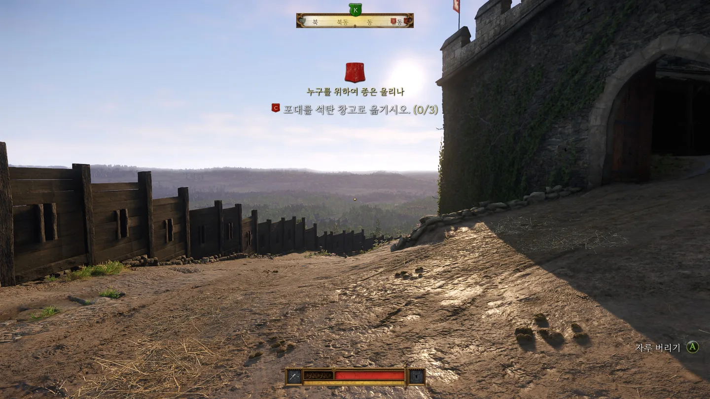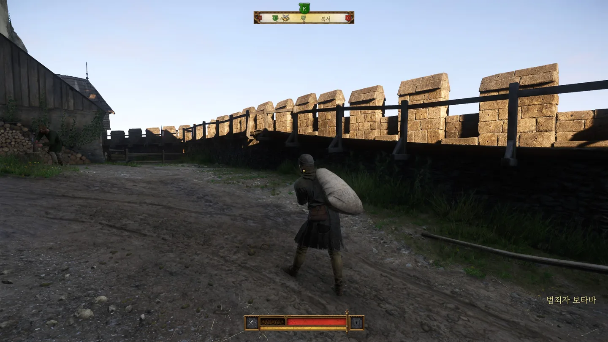

 킹덤 컴 2의 리드 디자이너였던 프로코프 이르사(Prokop Jirsa)는 플레이에서 발견한 마찰을 곧장 없애는 방식으로 일하지 않는다고 말했다. 불편과 어려움을 넘었을 때 실제 문제를 해결한 듯한 성취감을 얻을 수 있다는 것이다.[^friction] 연금술과 대장간에서는 그런 설명에 공감할 수 있었다. 재료와 가공법을 익히거나 쇠의 상태를 살피며 작업하고, 그렇게 직접 조작한 결과가 완성품의 품질로 이어지므로, 원하는 약이나 무기를 만들어 냈을 때에는 그 수고에 대한 보람도 느낄 수 있었다.

 헨리가 특정 목표를 위해 지루한 노동을 하고 있다는 경험을 주려는 의도라면, 그 효과는 충분히 달성했다고 볼 수 있다. 하지만 자루를 운반하는 동안에는 느려진 걸음으로 목적지까지 이동하는 것 외에 할 수 있는 일이 없다. 무엇을 살피고 어떻게 조작할지 판단할 여지도 적어, 그 불편함을 감수하는 과정에서 재미를 얻기는 어려웠다. 노동의 지루함은 충분히 전달됐지만, 그 지루함 자체가 **플레이어에게 반드시 전달되어야 할 경험**이었는지는 의문이다. 제작진도 이에 대해 인지하고 있는지, DLC <|대장간의 유산|>에서는 헨리가 낡은 대장간을 치우며 "포대 나르기...질리지가 않는다니깐."이라는 대사로 자학하기도 한다.

 불편함을 직접 겪게 하는 것이 이야기에서 중요한 역할을 했던 경우도 있다. [<<데스 스트랜딩>>](/review/deathstranding/#beach-waiting)(Death Stranding)에서는 해변에서 오랜 시간을 기다린 샘의 경험을 전달하기 위해, 플레이어도 한동안 해변을 떠돌게 한다. 언제 끝날지 알 수 없는 시간을 직접 보내는 이 장면 역시 지루하게 느껴질 수 있다. 하지만 샘이 얼마나 오래 기다렸는지를 체감하는 것은 이야기에서 중요한 의미가 있었고, 그렇기에 그 시간을 납득할 수 있었다.

 자루 운반에서는 그만큼의 의미를 느끼지 못했다. 헨리가 하는 일이 고되다는 것을 알리기 위해 플레이어의 행동을 제한하고 이동을 느리게 만들었지만, 그렇게 보내는 시간이 모험을 더 흥미롭게 하거나 이야기를 더 깊이 이해하게 하지는 않았다. 반복이 이어지면서 이미 느꼈던 지루함만 더 커졌다. 노동의 불편함을 충실히 옮겼다는 것만으로, 그것을 이만큼 직접 수행하게 할 이유까지 충분해지는 것은 아니다.

### 전투

 킹덤 컴 시리즈 전투의 가장 큰 특징이라면 공격 방향을 고르고 방어 타이밍을 맞추는 공방이 중요하다는 점이다. 상대가 무기를 들고 있지 않은 방향을 공격하면 상대가 완벽한 방어를 할 확률이 낮아진다. 일반적인 방어는 방어 버튼을 누르고 있으면 되지만, 상대의 공격에 맞추어 버튼을 누르면 완벽한 방어를 할 수 있다. 현실의 검술에서 이루어지는 공방을 플레이어의 판단과 조작으로 수행해야 하는 것이다.

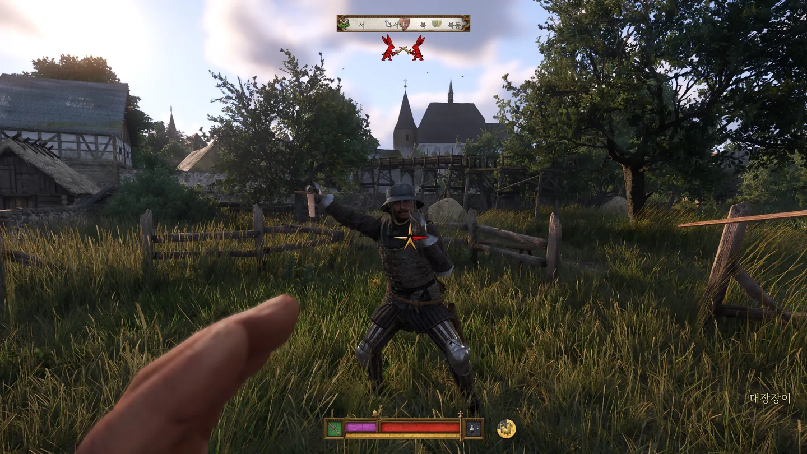

 완벽한 방어의 타이밍은 화면 가운데 나타나는 녹색 방패 문양으로 알려 준다. 다만 상대의 공격 방향을 알려 주는 별도의 UI는 없으므로, 공격 방향을 읽어야 할 때에는 상대의 애니메이션을 살펴야 한다. NPC들은 대기 자세에서 공격 직전에 방향을 바꾸기도 하므로, 그 움직임을 읽는 일도 익숙해지기 전까지는 쉽지 않다. 완벽한 방어를 성공적으로 해내면 즉시 반격을 할 수 있지만, 상대 역시 완벽한 방어로 이를 막을 수 있어 전투 시간도 짧지 않다.

 여러 적에게 둘러싸인 싸움은 더욱 부담스럽다. 다수의 적들이 서로 다른 위치에서 공격해 오므로 여러 적의 움직임과 공격 타이밍에 모두 대응하기는 어려우며, 1인칭 시점이기에 등 뒤의 공격에도 취약하다. 이러한 지점 때문에 일대다 전투를 기피하게 되며, 전투를 함부로 시작하지 않게 되는 점도 자연스러운 현실 반영이라 할 수 있겠다.

 공방 중에 새로운 변수를 만들어 낼 수단도 충분하지 않다. 검술 기술은 정해진 방향으로 공격을 정확히 이어 가는 콤보를 중심으로 구사해야 한다. 기술을 쓰려면 상대의 방어와 반격에 대응하면서도 필요한 연속 공격을 성공시켜야 하는 것이다. 원하는 순간에 기술을 써서 공방의 흐름을 끊을 수단이 적다 보니, 상대의 빈틈을 기다리며 비슷한 공방을 반복하게 된다.

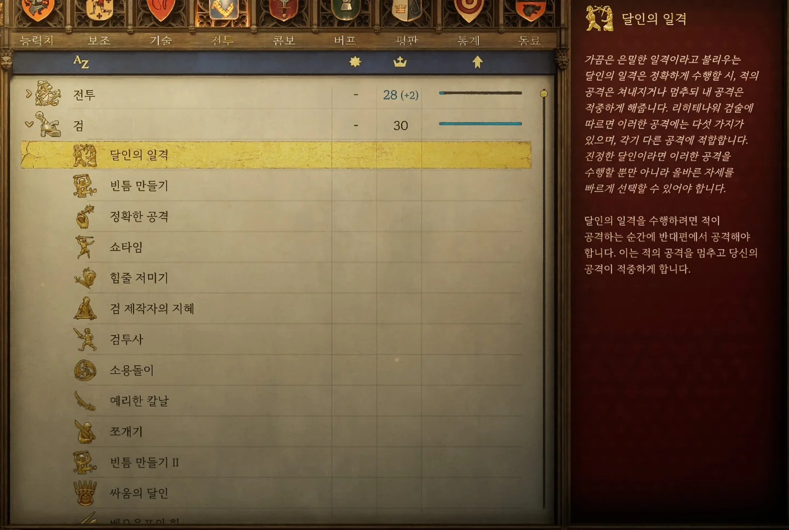

 '달인의 일격'은 이러한 공방을 단숨에 깨뜨릴 수 있는 수단이다. 상대의 공격을 쳐내면서 동시에 공격하므로, 반격마저 다시 막히는 공방을 끊고 피해를 줄 수 있다. 2편에서는 이 기술의 사용 조건과 동작이 바뀌었다. 전작에서는 달인의 일격 하나로 대부분의 싸움을 풀 수 있었지만, 이번에는 검 종류로만 쓸 수 있고 상대가 공격하는 순간 반대 방향에서 공격해야 발동한다. 사용 조건은 까다로워졌지만, 타이밍에 익숙해지면 대부분의 적에게 효과적으로 대응할 수 있다는 점에서 여전히 강력하다.

 개발진은 검의 복잡한 기술과 메이스·도끼의 단순한 조작으로 무기별 차이를 두었다고 설명한다.[^press-start] 이러한 시도를 통해 모든 무기에서 달인의 일격에만 의존하는 전투 구조는 벗어날 수 있었지만, 다른 무기를 사용해야 할 이유는 줄었다. 익숙한 반격으로 충분히 싸울 수 있으니, 다른 무기의 조작을 익히고 그 이점을 알아볼 필요가 줄었기 때문이다.

 이런 아쉬움을 생각하면, [<<블러드 오브 던워커>>](/review/bloodofdawnwalker/)의 접근을 살펴볼 만하다. 기본 난이도에서는 상대의 공격 방향을 UI 상에 표시해줘서 어느 쪽에서 공격해 오는지 알아보기 용이하다. 다만 킹덤 컴에 같은 표시를 넣는다면, 상대의 자세와 동작을 직접 읽는 비중은 줄어들 것이다. 주술과 뱀파이어 능력으로는 공방의 리듬을 깨고 싸움의 흐름을 바꿀 수 있다. 킹덤 컴에서도 달인의 일격처럼 특정 상황에서 뚜렷한 이점을 주는 기술이나 퍽을 무기별로 강화했다면, 공방에 변화를 주면서 상대와 상황에 따라 무기를 바꿔 사용할 필요도 커졌을 것이다.

 상대의 동작을 읽고 정해진 연속 공격을 수행하게 하는 방식은 현실의 검술을 충실히 모방하려는 시도로 보인다. 상대를 읽고 반격하는 재미와 기술을 익힌 보람은 있었지만, 반복되는 공방의 흐름을 바꾸거나 무기마다 다른 특성을 활용하는 재미는 충분히 살리지 못했다.

### 생활과 옷차림

 헨리는 시간이 지나면 배가 고프고 피로가 쌓이며, 몸과 옷도 더러워진다. 모험을 계속하려면 먹을 것을 구하고 잠자리를 찾고 몸을 씻어야 한다. 이렇게 피로와 허기, 청결을 관리하는 방식은 생존 게임이나 인생 시뮬레이터에서도 흔히 볼 수 있다.

 다만 이 게임의 중심은 생활 스탯의 관리가 아닌 만큼 어렵지는 않다. 헨리는 매일 삼시세끼를 먹지 않아도 되고, 조금만 자도 피로를 쉽게 회복한다. 먹을 것을 구하는 것도 어렵지 않으며, 옷과 몸을 씻을 수 있는 연못과 물통은 멀지 않은 간격으로 배치되어 있다. 반복해야 하는 간격이 길고 필요한 것을 가까이에서 구할 수 있어, 생활을 유지하는 일이 모험을 방해할 정도는 아니다.

 옷차림과 청결은 사람들의 대우와 대화의 판정에 영향을 준다. 초반에 헨리가 트로스키 성에서 박대받았던 것처럼, 초라한 옷이나 씻지 않은 몸은 상대의 반응을 나쁘게 만든다. 옷의 상태와 핏자국은 매력에도 영향을 주므로, 설득해야 하는 사람이 있다면 옷과 몸을 깔끔히 한 이후에 하는 편이 좋다.

 옷차림은 은신과 전투에도 영향을 준다. 소음이 적은 옷은 숨어 다닐 때 유리하고, 방어도가 높은 갑옷은 싸울 때 필요하다. 한 벌로 모든 상황에 대응하기 어려우므로 하려는 일에 따라 갈아입어야 하는데, 그때마다 장비를 하나씩 바꾸는 것은 번거로운 일이다.

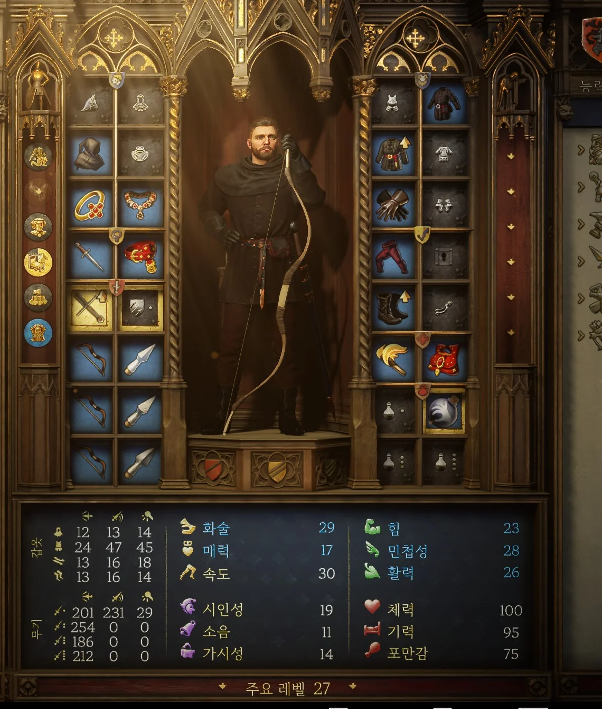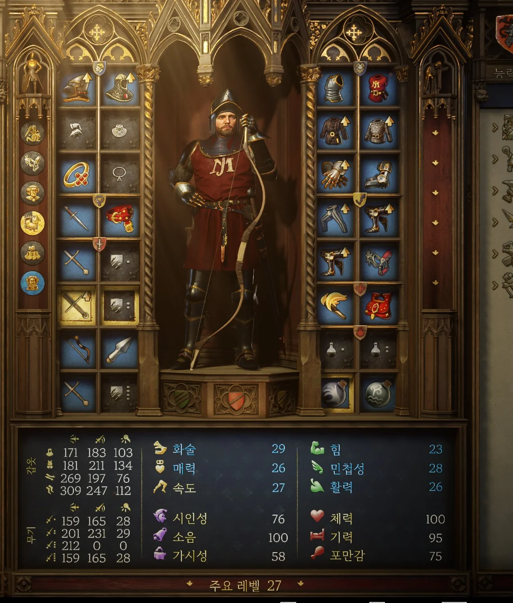

 장비 세트는 그 수고를 줄여 준다. 이 게임은 장비 세트를 세 벌까지 준비해 두고 키 하나로 갈아입을 수 있다. 옷차림에 따른 변화를 표현하면서도 갈아입는 과정은 간소화한 것이다.

 먹고 자고 씻으며 상황에 맞는 옷을 갖추는 일은 중세의 생활을 직접 체험하게 한다. 관리 주기를 길게 두고 갈아입는 과정을 간편하게 만든 덕분에, 이런 생활을 챙기는 일이 지나친 번거로움으로 이어지지도 않는다. 현실을 모방하는 과정에서 게임으로서의 편의성도 고려한 부분이다.

### 경제

 게임에서 얻은 장비나 물약, 식량 등은 직접 쓰거나 상인에게 팔 수 있다. 물건을 거래하는 과정에도 현실의 거래와 닮은 점이 있다. 상인들의 지갑에는 한계가 있으므로 그들에게 무한정 물건을 팔 수 없다. 훔친 물건은 대부분의 상인이 사들이지 않으므로 장물아비에게 팔거나, 다른 도시에 가서 팔아야 한다. 거래할 때에는 원하는 가격을 제시하고 상인의 반대 제안에 응하며 흥정할 수 있다. 지나친 요구를 거듭하면 상인이 거래를 거부하고 평판도 떨어지지만, 값을 조금 더 쳐주어 평판을 높일 수도 있다.

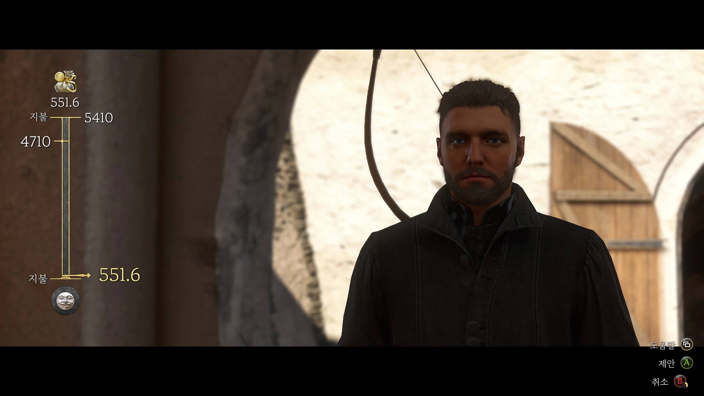

 그러나 플레이타임이 길어질수록 상인에게서 새로 살 물건은 점점 줄어든다.

 연금술로 만드는 물약은 사용하면 소모되므로 끊임없이 수요가 발생한다. 물론 연금술에 능숙해지면 상점에서 파는 것보다 높은 등급의 물약을 만들 수 있다. 그래도 풀밭 어디에 있을지도 모르는 야생꽃과 각종 재료들을 찾아다니는 것보다는 상인에게서 재료를 사들이는 것이 훨씬 간편하다. 물약을 직접 만들어 쓰더라도 주기적으로 상인에게 들를 이유는 충분한 것이다.

 하지만 무기와 방어구는 자신이 쓸 장비를 갖추고 나면 같은 물건을 여럿 마련할 필요가 없다. 최고 등급의 장비를 수리하며 계속 사용할 수 있으므로, 수리 도구를 보충하는 것 외에 새 장비를 구매할 필요는 없다. 대장장이 퍽을 찍다 보면 직접 제작으로만 얻을 수 있는 최고 품질의 무기를 만들 수 있게 되므로 더더욱 무기 장인을 찾지 않게 된다.

 더구나 필요한 장비를 전리품으로 얻으면 구매하거나 직접 만들 필요는 더 줄어든다. 2막에서는 판금 갑옷으로 무장한 적들에게서 장비를 얻고, 남는 갑옷을 팔아 손쉽게 돈을 모을 수 있었다. 이 또한 현실성을 갖추기 위함인지는 모르겠지만, 판금 갑옷은 대개 다른 상품에 비해 매우 높은 가격대에 판매된다. 각 상인들의 지갑이 모두 털릴 때까지 갑옷을 팔고, 도시를 돌며 돈이 남은 상인들을 찾아다녀도 갑옷은 창고에 쌓이게 된다.

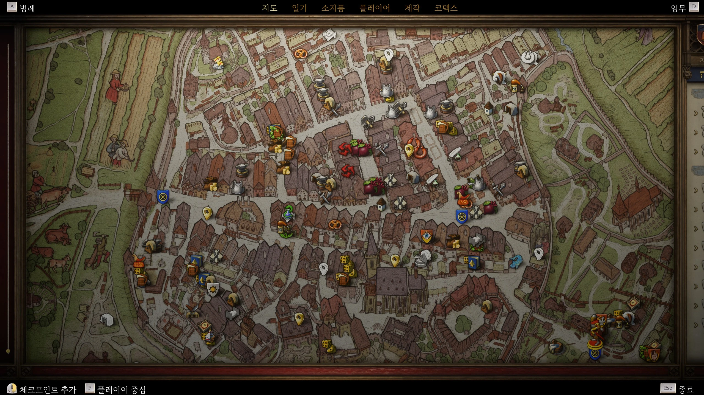

 만약 헨리에게 필요한 장비가 모두 갖춰진 뒤에도 다른 사람이 물건을 필요로 한다면 제작은 계속할 수 있다. DLC <|대장간의 유산|>에서는 이를 보완할 플레이 루프가 추가되었다. 게임 내 하루마다 주문이 하나씩 들어오며, 이 물건을 납품하면 보수와 함께 대장장이 명성이 높아진다.

 그러나 주문을 받아 제작하는 것보다 전리품을 가져다 파는 편이 더 많은 돈을 벌 수 있었다. 그리고 가장 치명적인 부분은, 그렇게 돈을 벌어도 쓸 곳이 마땅치 않다는 점이다. DLC에서 추가된 하우징을 통해 어느 정도 모인 재화를 소모할 수 있지만, 모아 둔 돈을 계속 활용하기에는 충분하지 않았다. 손님들이 매일 주문을 하지만, 명성이 어느 정도 쌓이면 굳이 계속 제작에 시간을 쓸 필요는 없었다.

 DLC는 다른 사람의 수요를 통해 제작을 이어갈 목적을 마련했다. 하지만 보상으로 얻은 돈을 활용할 곳은 여전히 부족했다. 커스터마이징이나 장인 주문은 이 남은 문제를 보완할 가능성이 있다. 전리품으로 충분한 성능의 장비를 얻었더라도, 원하는 외형과 차림을 갖추기 위해 재료를 사거나 장인에게 제작을 맡길 수 있기 때문이다. 이런 재화 소모처가 있었다면 후반에도 돈을 벌고 쓰는 재미가 이어졌을 것이다.

 경제가 중심인 게임은 아니므로, 후반에 돈이 넉넉해지는 것 자체는 큰 문제가 아닐 수 있다. 하지만 여러 방면에서 현실을 잘 모방해 재미를 더했던 만큼, 물건을 만들어 팔고 그 돈으로 필요한 것을 마련하며 살아가는 기본적인 경제 흐름이 후반까지 충분히 이어지지 못한 점은 아쉽다.

## 세계와 표현

 헨리가 사람들을 만나고 일을 해결하는 무대는 실제 지형과 마을, 건물을 바탕으로 만들어졌다. 전작의 사자바(사사우) 일대에 이어, 이번에는 두 개의 오픈월드 지역으로 나뉜다. 1막에서는 프라하 동북쪽의 체스키 라이, 이른바 보헤미안 파라다이스에 자리한 트로스키 성과 젤레요프, 세민 일대를 돌아다닌다. 2막에서는 프라하 동쪽의 쿠텐버그로 옮겨 가 도시와 미스코비츠, 말레쇼프 등 주변 마을을 탐험한다. 두 지역은 서로 다른 지도로 나뉘어 있고, 2막에 들어선 뒤에는 마차로 오갈 수 있다.

 실제 지도와 나란히 보면 마을들이 놓인 방향과 서로의 위치에서도 닮은 점이 보인다. 트로스키 성 남서쪽의 젤레요프나 쿠텐버그 서쪽의 미스코비츠처럼, 게임에서 오가던 장소를 현실의 지도에서도 찾아볼 수 있다.

 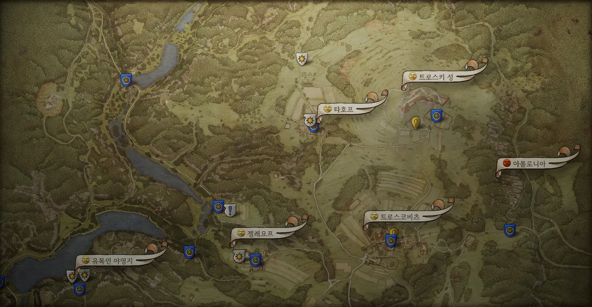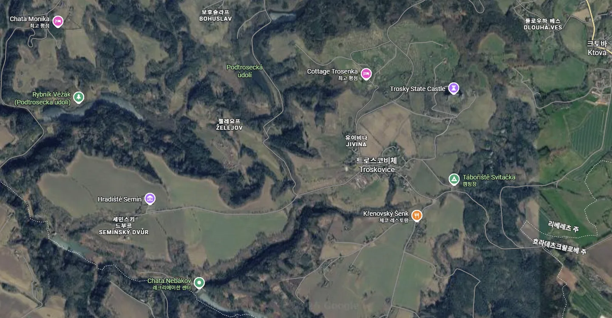

 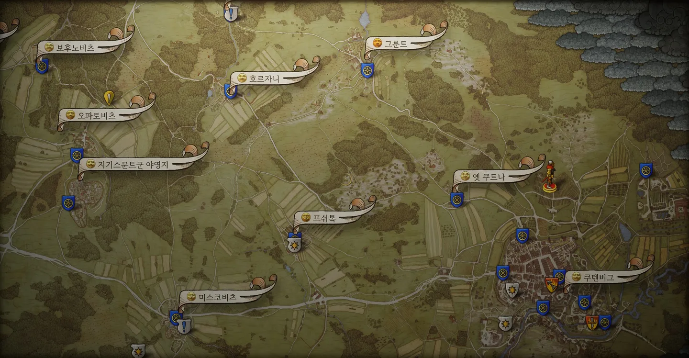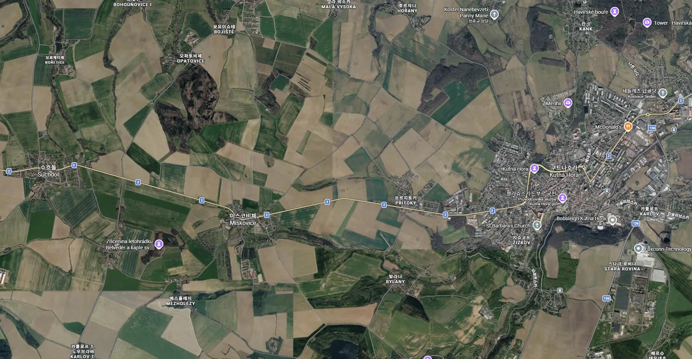

 트로스키에서는 자연의 풍경이 먼저 눈에 들어온다. 숲과 들판 사이로 바위 지형이 드러나고, 그 사이에 작은 마을과 방앗간이 흩어져 있다. 마을 안에서도 몇 채의 집과 울타리 너머로 주변의 숲과 들판이 보인다. 높은 바위 위에 세워진 트로스키 성을 제외하면, 건물들이 풍경을 가득 채우는 곳은 드물다.

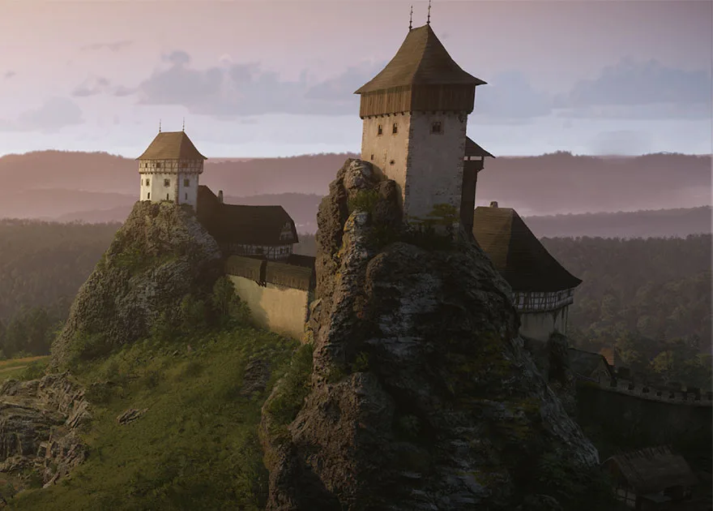 · [CC BY-SA 3.0](https://creativecommons.org/licenses/by-sa/3.0/)")

 쿠텐버그 지역에서는 마을의 규모부터 달라진다. 비교적 큰 마을들을 거쳐 쿠텐버그에 들어서면, 길을 따라 늘어선 건물들이 시야를 채운다. 상점과 장인의 일터가 이어지고, 분수가 있는 광장에는 사람들이 오간다. 집들 너머로 솟은 성 야고보 성당과 이탈리아 궁전까지 둘러보면 도시의 규모가 한층 실감 난다.

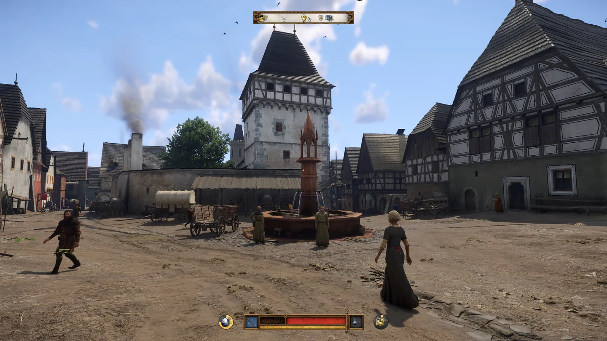 · [CC BY-SA 3.0](https://creativecommons.org/licenses/by-sa/3.0/)")

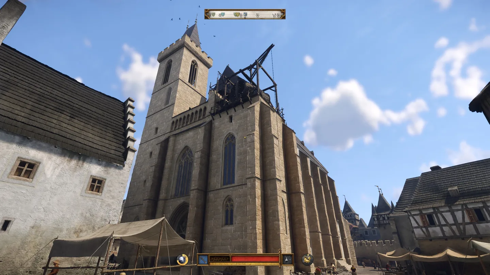 · [CC BY-SA 3.0](https://creativecommons.org/licenses/by-sa/3.0/)")

")

 건축물에서도 트로스키 성의 두 탑과 그 사이의 성벽, 성 야고보 성당의 높은 종탑, 이탈리아 궁전 안뜰의 예배당 등 실제 건물과 닮은 형태가 눈에 들어온다. 동시에 닮은 점만큼 다른 점도 눈에 띈다. 지금의 트로스키 성은 1648년 30년 전쟁 중에 불탄 뒤 폐허로 남았지만, 게임 속에서는 14세기 말에 세워진 성이 온전하게 남아 있는 모습이다. 쿠트나 호라의 석조 분수는 게임의 배경보다 90년쯤 뒤인 1495년에 완공됐고, 게임 속 광장의 분수는 그와 생김새가 다르다. 1330년대에 짓기 시작해 1420년에야 완공된 성 야고보 성당의 지붕 위에는 기중기가 올라가 있다. 이렇듯 게임은 여러 자료와 상상력을 동원해 1403년 보헤미아의 모습을 재구성하려 했다.

 풍경과 건물은 실제 장소를 알아볼 수 있을 만큼 공들여 옮겼고, 그래픽도 전작보다 크게 발전했다. 다만 세부적인 표현은 고르지 않다. 전투 애니메이션의 전환은 부자연스럽고, 일부 텍스처의 품질도 아쉬웠다. 그럼에도 불구하고 몰입을 깨뜨릴 정도는 아니었다.

## 정리

 <<킹덤 컴 딜리버런스 2>>는 플레이어로 하여금 현실의 행동과 절차를 직접 수행하게 하며 중세의 삶을 체험하게 한다. 15세기 보헤미아를 실제 지형과 건축물을 바탕으로 재구성하여 그 시대를 살아가는 감각을 생생하게 만든다.

 이 세계에서 살아가는 데에는 손이 많이 간다. 직접 하는 과정에서 발견과 성취를 얻기도 하고, 사소한 생활을 챙기며 헨리가 처한 상황을 실감하기도 한다. 현실적인 생활을 요구하면서 게임으로서의 편의성도 고려한 점은 좋았다. 하지만 직접 수행하는 과정이 언제나 그만한 가치를 주지는 않았다. 노동의 지루함을 충실히 전달했더라도, 그 시간을 반복해서 겪는 일이 모험이나 이야기에 충분히 기여하지 못했다면 불편함을 재현한 성과만으로 납득하기는 어렵다. **현실과 얼마나 닮았는지도 중요하지만, 그것이 플레이어에게 어떤 경험으로 다가오는지가 더욱 중요하다.**

 모험이 길어질수록 이 풍부한 세계를 즐기는 방식에도 한계가 드러났다. 물건을 만들고 거래하는 과정에 비해, 벌어들인 돈으로 필요한 것을 마련하는 경제 흐름은 후반까지 충분히 이어지지 못했다. 결말에서 던지는 복수와 희생, 행동의 책임에 관한 질문도 그동안 모험을 즐기며 얻은 경험과는 거리가 있었다.

 그렇다고 그 한계가 이 게임에서 느꼈던 경험의 가치를 크게 훼손하지는 않았다. 주변 인물들의 이야기는 그 자체로 다음 일을 궁금하게 하고, 모험을 계속하고 싶게 했다. 역사 속 장소에서 그들의 사정에 관심을 기울이고, 일을 배우고 생활을 챙기는 경험이 함께 모험을 풍부하게 만들었다. 마법과 용 없이 중세의 삶을 RPG로 옮기겠다던 워호스 스튜디오의 도전은 전작보다 한층 풍성한 모험으로 구체화되었다.

 이 모험은 현실의 공간까지 확장되었다. 워호스와 체코 관광청이 협력한 관광 프로그램, '킹덤 컴 라이브(Kingdom Come Live)'에서는 게임에 등장하는 지역을 둘러보는 가이드 투어를 비롯해 말레쇼프에서의 귀족식 연회와 중세 군용 텐트에서의 숙박 등 다양한 체험 프로그램을 운영한다.[^kcd-live] 이 체험 프로그램 외에도, 관련 커뮤니티에서는 게임에서 드나들던 거리와 건물을 찾아가는 이른바 '성지 순례' 여행기를 쉽게 찾아볼 수 있다.[^kcd-pilgrimage] 이는 게임이라는 매체 안에서 현실의 행동과 절차를 직접 수행하며 얻은 재미가, 화면 밖에서도 그 시대의 삶을 체험해 보고 싶은 마음으로 이어질 가능성을 생각하게 한다. <<킹덤 컴 딜리버런스 2>>는 중세의 삶을 매력적인 모험으로 옮기고, 그 모험의 무대를 오늘날의 체코까지 넓혀 놓았다. 이 게임을 플레이한 이후라면, 체코를 처음 방문하는 여행객이라도 한때 그곳에서 살았던 듯한 반가움을 느낄지 모른다.

{}

[^official-story]: [PlayStation 한국 공식 소개](https://www.playstation.com/ko-kr/games/kingdom-come-deliverance-ii/)

[^kcd-kickstarter]: Greg Micek, [Dan Vávra Discusses Kingdom Come: Deliverance](https://cliqist.com/2014/02/07/dan-vavra-discusses-kingdom-come-deliverance/), Cliqist, 2014-02-07.

[^kcd-local-history]: CraigB, [Kingdom Come: Deliverance Developer Interview](https://uk.gamesplanet.com/community/kingdom-come-deliverance-steam-key--3316-1/news_updates/2185-kingdom-come-deliverance-developer-interview), Gamesplanet, 2015-12-07.

[^kcd-reconstruction]: Jan Velinger, [Role-playing game Kingdom Come: Deliverance promises historically accurate adventure in 15th century Bohemia](https://english.radio.cz/role-playing-game-kingdom-come-deliverance-promises-historically-accurate-8210854), Radio Prague International.

[^kcd-live]: CzechTourism, [Kingdom Come: Deliverance 2 Comes to Life in Kutná Hora, Trosky, Rataje, and Malešov](https://www.visitczechia.com/en-us/news/2025/03/n-kingdom-come-live-in-czechia), 2025-03-14.

[^kcd-pilgrimage]: 디시인사이드 킹덤컴 딜리버런스 마이너 갤러리, [드디어 써보는 체코 성지순례기. 2 (스포 있을 수 있음)](https://gall.dcinside.com/mgallery/board/view/?id=kingdomcomegame&no=169928), [보헤미아 여행기 2 - 쿠텐버그](https://gall.dcinside.com/mgallery/board/view/?id=kingdomcomegame&no=172512), [보헤미아 여행기 3 - 트로츠키](https://gall.dcinside.com/mgallery/board/view/?id=kingdomcomegame&no=172516).

[^friction]: Joshua Wolens, [Warhorse's new creative director tells us why the secret sauce for Kingdom Come Deliverance is making things difficult for players](https://www.pcgamer.com/games/rpg/warhorses-new-creative-director-tells-us-why-the-secret-sauce-for-kingdom-come-deliverance-is-making-things-difficult-for-players-the-usual-answer-is-ok-lets-get-rid-of-the-friction-we-dont-work-like-that/), PC Gamer, 2026-05-07.

[^press-start]: Matthew Zimmari, [We Spoke To The Kingdom Come: Deliverance 2 Team About The Brutal Combat And Living World](https://press-start.com.au/features/2024/12/05/we-spoke-to-the-kingdom-come-deliverance-2-team-about-the-brutal-combat-and-living-world/), Press Start, 2024-12-05.
