{}

 중세 수도원에서 벌어지는 살인 사건이라고 하면, 많은 사람들이 움베르토 에코(Umberto Eco)의 <<장미의 이름>>(Il nome della rosa)을 먼저 떠올릴 것이다. 1327년, 프란치스코회 수도사 바스커빌의 윌리엄과 그의 제자인 수련사 멜크의 아드소는 신학 논쟁에 참석하기 위해 북이탈리아의 한 베네딕토회 수도원을 찾는다. 그리스도와 사도들이 재산을 가졌는지를 두고 교황청과 프란치스코회가 맞서는 자리로, 성서를 누가 어떻게 해석할 것인가를 두고 벌어진 싸움이었다. 교회의 해석과 다른 믿음을 가진 이들이 이단으로 몰려 화형대에 오르던 시대이기도 했다.

 그런데 이들이 도착하기 직전 한 수도사가 의문의 죽음을 맞았고, 이후로도 수도사들이 연이어 죽어 나가면서 윌리엄은 수도원장의 부탁을 받아 사건을 조사하게 된다. 그리고 조사가 이어질수록 이 연쇄 살인의 한가운데에는 책 한 권이 자리하고 있다는 것이 드러난다. 어떤 책은 끝내 읽혀서는 안 된다고 믿은 사람이 있었고, 그 믿음은 결국 수도원이 쌓아 온 모든 책을 위태롭게 만들었다.

 15세기 구텐베르크가 인쇄기를 발명한 이후, 책은 더 이상 수도원 장서관에만 있는 물건이 아니게 되었다. 일부 성직자와 귀족들만이 지식을 독점하던 시대에서 벗어나, 평범한 도시민뿐만 아니라 토지에 매인 농노들마저 책을 쉽게 접할 수 있게 된 것이다. 그렇게 지식이 퍼져 나가며, 마침내 1517년 마르틴 루터(Martin Luther)는 성서를 성직자의 해석에 기대지 않고 스스로 읽어야 한다고 주장하기에 이르렀다.

 <<펜티먼트>>(Pentiment)는 바로 이 시대, 종교개혁의 불씨가 막 번지기 시작하던 16세기 바이에른의 한 마을과 수도원을 무대로 한 내러티브 어드벤처 게임이다. 플레이어는 뉘른베르크 출신의 젊은 화가 **안드레아스 말러**가 되어, 장인이 되기 전 마지막 수련으로 타싱 마을 근처의 키르자우 수도원 기록실에서 필사본에 들어갈 그림을 그린다. 필사본을 찾는 이가 점점 줄어드는 가운데, 이곳은 유럽에서도 몇 남지 않은 기록실 중 하나로 힘겹게 명맥을 잇고 있다. 안드레아스는 마을 농가에 묵으며, 이웃들과 어울리는 평범한 나날을 보낸다.

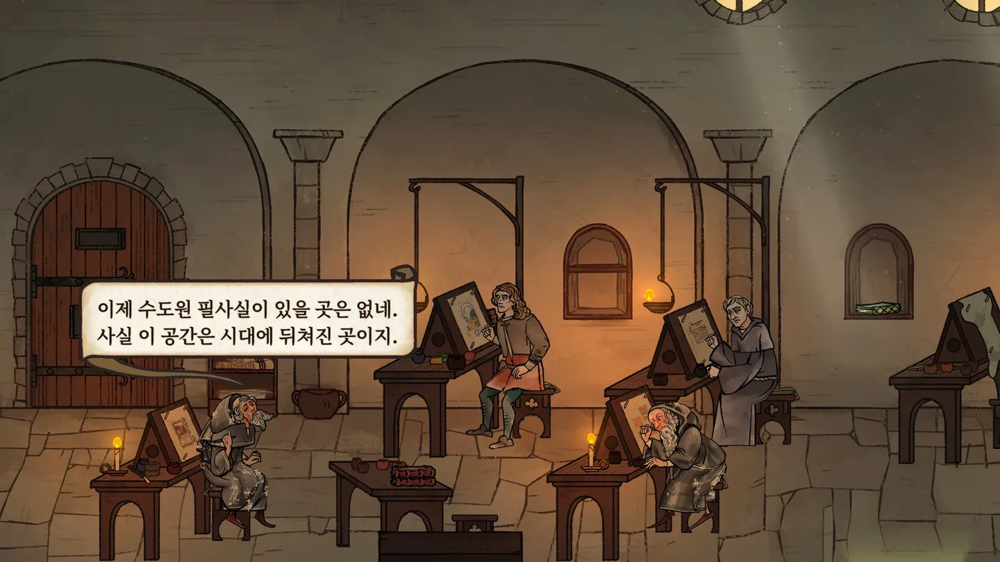

 그러던 어느 날, 기록실을 후원하던 한 귀족이 수도원을 찾았다가 살해되고, 안드레아스의 스승이자 친구인 피에로 수사가 범인으로 몰린다. 안드레아스는 그를 구하기 위해 사건을 조사하게 된다.

 외딴 수도원과 그 안의 기록실, 그곳에서 벌어진 살인과 사건을 파헤치는 외지인까지, 펜티먼트는 여러 면에서 장미의 이름을 떠올리게 한다. 다만 소설에서는 작가가 이끄는 대로 이야기를 따라가면 되지만, 이 게임에서는 누구를 찾아가 어떤 증언과 증거를 모을지를 플레이어가 정해야 한다. 사건을 지켜보는 독자가 아니라, 직접 범인을 골라야 하는 탐정의 자리에 서게 되는 것이다.

 그렇다면 펜티먼트는 작가가 이끌어 주지 않는 이 미스터리를 어떻게 플레이어의 몫으로 옮겨 놓았을까.

{}이 글에는 1막부터 3막, 결말까지의 내용이 포함되어 있다.{}

## 스토리

> 종교와 정치 변화의 교차로에 선 유럽에서, 채색된 필사본과 인쇄된 목판화에서 영감을 받은 살아있는 일러스트의 세계로 들어가세요. 바이에른 알프스산맥에서 살인, 스캔들, 음모에 휩싸인 자신을 발견한 거장 예술가 Andreas Maler의 발자취를 따라 걸어보세요.[^official-story]

 게임은 한동안 안드레아스의 일상을 따라간다. 하루는 수도원의 기도 시간에 맞춰 흘러가고, 안드레아스는 기록실에서 일하다가 끼니때가 되면 마을로 내려와 이 집 저 집의 식탁에 앉는다. 그가 하숙하는 게르트너 가족은 그를 반갑게 맞아 주지만 수도원이 매기는 세금에 허덕이고 있고, 인쇄업자 클라우스의 드루커 가족처럼 수도원과는 다른 방식으로 먹고사는 이웃도 있다. 처음 며칠 동안은 누가 누구에게 빚을 졌는지, 누가 수도원을 못마땅해하는지, 어느 집에 어떤 사정이 있는지를 식탁에서 하나씩 들으며 이웃들을 알아 가게 된다.

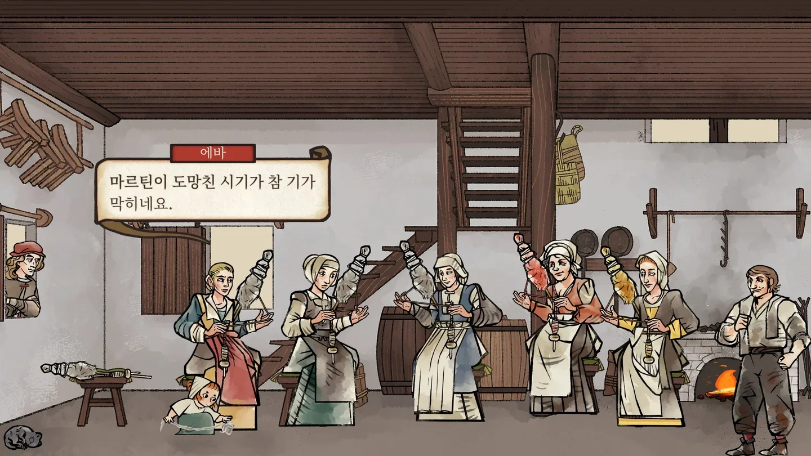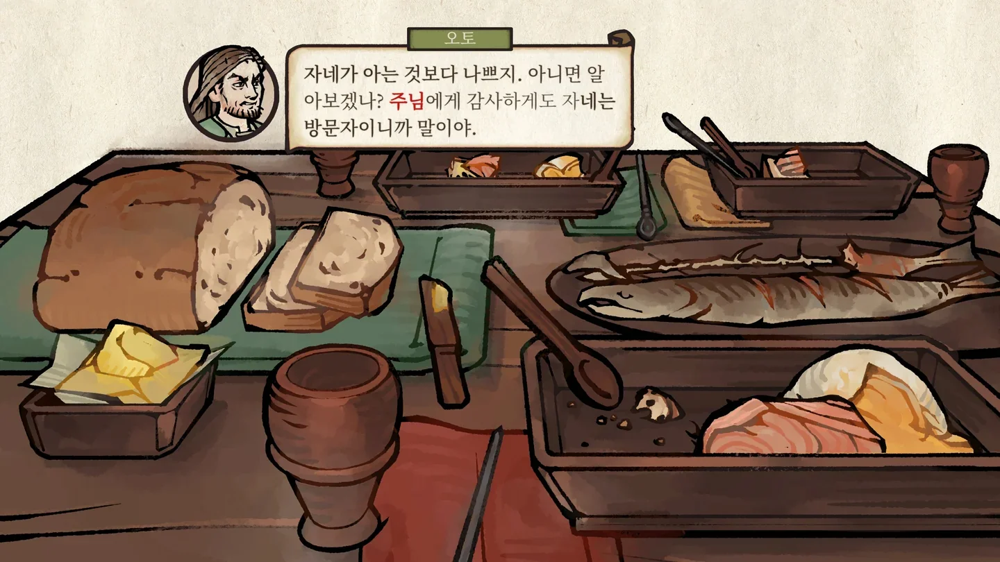

 수도원 안의 사정도 넉넉하지 않다. 기록실이 예전만큼 수입을 내지 못하자, 게르노트 수도원장은 후원자들에게 더욱 기대며 그들의 뜻을 거스르지 못하고, 마을에 매기는 세금도 갈수록 가혹해진다. 안드레아스의 스승 피에로 수사는 현명하고 겸손한 노수사지만 수도원장과는 사이가 썩 좋지 않다.

 그러던 중 기록실의 후원자인 로렌츠 로토펠트 남작이 수도원을 찾아온다. 남작은 안드레아스에게 호의를 보이며 다가오지만, 마을 사람들은 어째서인지 그에게 적대감을 드러낸다. 게르노트 수도원장과 페렌츠 부수도원장도 후원자인 그의 제멋대로인 행보를 차마 막지 못하는데, 그런 그들도 남작이 저녁 식사 자리에서 마르틴 루터의 종교개혁 이야기를 꺼내려 하자 이것만큼은 결사적으로 막아선다. 그런데 그 저녁 식사가 남작의 마지막 식사가 되고 만다. 다음 날, 남작이 수도원에서 시체로 발견된 것이다.

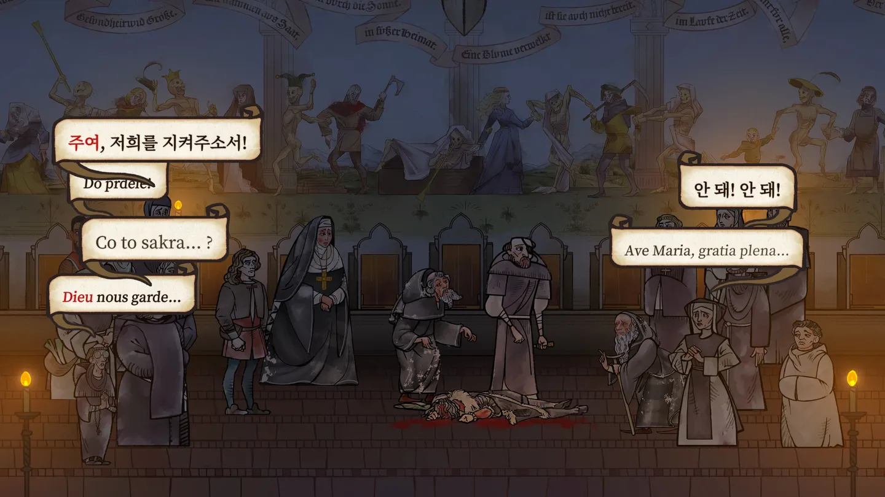

 수도원장은 피에로 수사를 범인으로 몰아 가둔다. 부주교가 와서 심문을 열기까지 남은 며칠 동안 안드레아스는 스승의 결백을 밝히기 위해 수도원과 마을을 오가며 조사를 시작하는데, 조사를 할수록 남작을 죽일 만한 이유를 가진 사람이 하나둘 늘어난다. 그들에게는 보랏빛 필체로 쓰인 쪽지가 전해져 있었고, 쪽지에는 남작이 그 사람에게 저지른 악행과, 남작을 노릴 수 있는 시간과 장소가 적혀 있다.

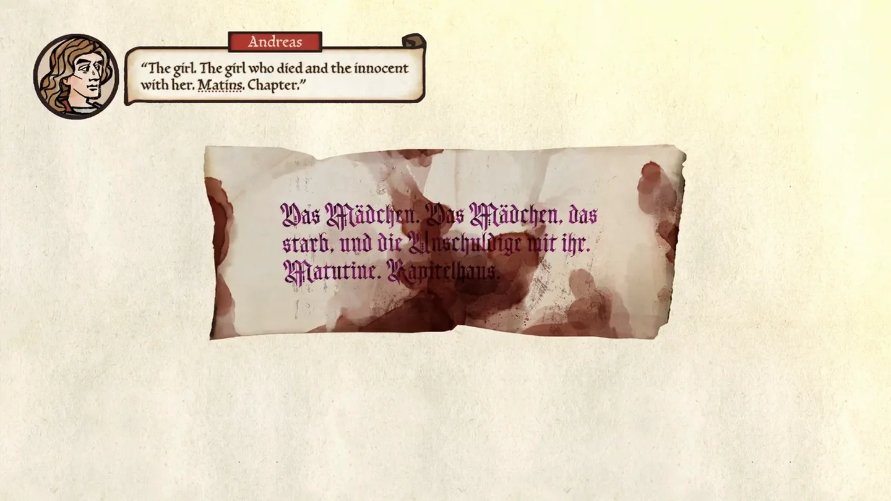

용의자로 떠오르는 사람들은 며칠 전 같은 식탁에 앉아 빵을 나눠 먹던 이웃들이다. 플레이어는 그들을 다시 찾아가, 그때 나누던 안부 대신 남작에게 품었던 원한을 묻고, 부주교가 도착하는 날 그중 한 사람을 범인으로 지목해야 한다.

### 추리라는 선택

 일반적인 추리 게임이라면, 사건에는 단 하나의 **진상**(眞相)이 있다. 플레이어는 흩어진 단서들을 모아 실제 사건을 재구성하고, 진범을 지목해야 한다. 이 과정에서 플레이어가 밝혀내야 할 것은 **범행 동기**와 **범행 수법**이다. 범행 동기가 있는 여러 용의자를 조사하고, 그들의 알리바이를 비교해 진상을 밝혀내는 과정에서 오는 서스펜스가 추리 게임의 핵심 재미라 할 수 있다. 어떤 게임에서는 단서를 빠짐없이 찾아내지 못하면 이야기를 더 진행할 수 없고, 엉뚱한 증거를 내밀면 페널티를 주기도 한다. 어떤 게임이든, 추리 게임에서 플레이어의 목표는 사건의 진상을 밝혀내는 것이다.

 안드레아스 역시 현장을 조사하고, 증언을 수집하고, 용의자를 추려 낸다. 다만 그에게는 시간이 부족하다. 모든 증인과 대화를 나눠 볼 수도, 모든 증거를 다 찾을 수도 없다. 추리물에서 용의자를 늘리는 것은 동기다. 그리고 그렇게 늘어난 용의자를 하나씩 지워 나가는 것은 범행 수법이다. 그런데 이 게임은 용의자들 중 그 누구라도 범인일 수 있다고 말하며 이런저런 동기들을 제시하지만, 범행 수법, 즉 **트릭**은 좀처럼 알려 주지 않는다. 끝까지 남는 것은 저마다 그럴듯한 동기를 가진 여러 사람이다.

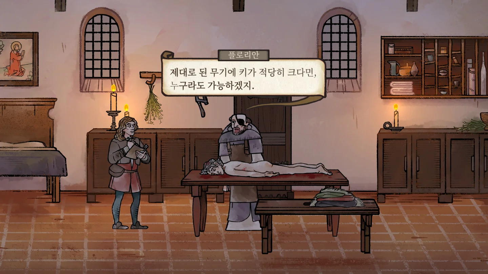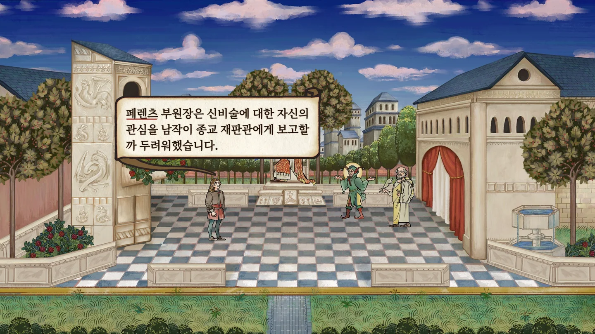

 게임은 추리물의 형식을 그대로 빌려 온다. 피해자가 쓰러지고, 그를 미워할 이유가 있던 사람들이 하나둘 드러나고, 플레이어는 그들을 차례로 찾아가 이야기를 듣는다. 익숙한 추리물의 도입 덕분에 플레이어는 따로 설명을 듣지 않아도 마을 사람들의 집 문을 두드리고, 그들이 무엇을 숨기고 무엇을 바라는지, 그리고 그들이 사는 시대가 어떤 곳인지 알아 가게 된다.

 하지만 펜티먼트는 플레이어가 진범을 찾는 것에는 관심이 없어 보인다. 그런데도 선택의 순간은 끝내 찾아오고 만다. 주장이 받아들여지면 지목된 사람은 처형되고, 그 결정은 되돌릴 수 없다. 게임은 그 답이 맞았는지 채점하지 않는다. 그 선택이 옳았는지도 보증해 주지 않는다. 다만 몇 년 뒤 다시 찾은 마을의 모습으로 그 선택의 결과를 보여 줄 뿐이다.

 안드레아스는 누군가를 범인으로 지목해야 한다. 플레이어는 누군가에게 그 책임을 지워야만 한다. 게임이 묻는 것은 결국 **누구에게 그 책임을 물을 것인가**다.

 이 모든 것은 의도된 설계다. 디렉터 조시 소여는 펜티먼트를 '탐정 게임'이라고 할 수 없다고 말했다.[^thegamer]
 대신 그는 **플레이어 스스로가 무엇을 중요하게 생각하는지**를 묻는다.

 > 만약 당신이 범죄의 책임자라고 생각하는 사람이 처벌받는 것이 가장 중요하다고 생각한다면, 특정 인물들을 지목하게 될 것입니다. 하지만 만약 당신이 그저 형편없다고 생각하고 처형당해야 마땅하다고 생각하는 인물들이 있다면, 아마도 그 사람들을 지목하게 될 것입니다.\
> ⋯\
> 확실히 알 수 없다는 사실을 받아들여야 하고, 어떤 사람들은 당신의 결정에 의문을 제기할 겁니다.\
> ⋯\
> 플레이어에게 틀렸다고 말하지는 않을 겁니다. ⋯ 오히려 '이런 사실을 알아냈고, 이런 선택을 했으며, 그에 따른 결과는 이렇다'는 것을 보여 주는 데 중점을 두는 거죠.[^thegamer]

 소여는 범인의 정체를 끝내 불확실하게 남겨 둔 것이 이 게임의 "근본적"인 선택이었다고 말한다. 법의학도 없던 시대의 정의는 애초에 우리가 생각하는 방식대로 작동하지 않았다는 것이다. 증거로 범인을 가려낼 수 없다면, 판결은 진실을 밝히는 일이라기보다 누군가를 범인으로 정하는 일이 된다. 소여의 말대로, 그렇게 내려진 정의는 종종 "공허하게" 느껴진다. 진범이 빠져나갔을지도 모르고, 죄 없는 사람을 벌했을지도 모르기 때문이다. 그리고 바로 그 의심 때문에, 플레이어는 자신의 선택 이후에 벌어지는 일들에 대해 더 큰 책임을 느끼게 된다.[^gamedev]

 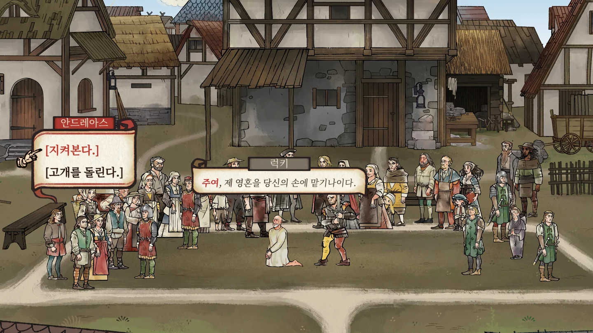

 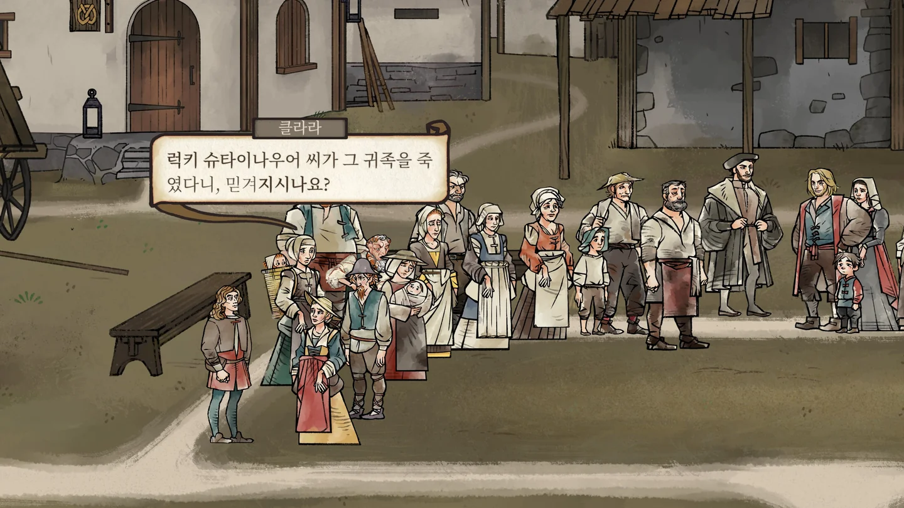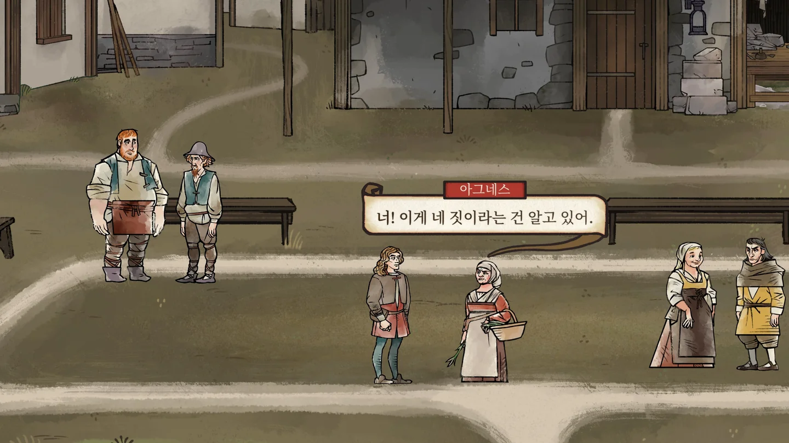

 물론 이런 설계가 모두에게 납득되는 것은 아니다. 추리물의 형식을 빌려 놓고 정답을 주지 않으니, 무엇을 골라도 비극으로 흘러가는 결말을 '의도'라는 말로 포장한 것 아니냐는 비판도 있다. 플레이하는 동안에는 이 게임이 정답을 맞히는 게임이 아니라는 사실을 알기 어렵기 때문에, 추리물을 기대하고 시작한 플레이어에게는 속았다는 느낌이 들 수도 있다.

 하지만 무엇을 골라도 의미가 없다는 비판에는 동의하기 어렵다. 이야기의 큰 줄기가 크게 바뀌지 않는 건 아쉽지만, 같은 결말에 이르더라도 그 사이에 플레이어가 겪는 경험은 같지 않다. 누구의 집을 먼저 방문했는지, 누구의 이야기를 끝내 듣지 못했는지, 어떤 기준으로 범인을 지목했는지에 따라 책임의 무게도 달라진다.

 펜티먼트가 공을 들인 곳도 바로 그 과정이다. 누군가를 고른 이유는 그동안 플레이어가 보고 듣고 저울질한 것들에 있고, 그 이유가 옳았는지는 누구도 말해 줄 수 없다.

### 남겨진 것들

 1518년에 시작한 이야기는 막이 바뀔 때마다 몇 년씩 시간을 건너뛰어, 1525년과 1543년으로 이어진다. 그 사이 타싱은 몇몇 사람을 떠나보냈다. 안드레아스가 범인으로 지목했던 이뿐 아니라, 세월 속에 잃은 이도 그렇다. 마을은 그 빈자리를 안고 다음 막을 맞는다.

 1막에서 남작을 죽인 범인은 밝혀졌지만(또는 그렇게 믿어졌지만), 용의자들을 충동질한 보랏빛 필체의 주인은 여전히 미궁 속이다. 2막에서도 그는 자신의 믿음을 관철하기 위해 또다시 누군가를 충동질한다. 다시 살인이 일어나고, 플레이어는 다시 누군가를 지목하고, 지목된 사람은 이번에도 죽는다.

 플레이어의 선택이 바꿀 수 있는 것은 생각보다 적다. 누구를 지목했느냐에 따라 마을 사람들의 태도와 몇몇 사건은 달라지지만, 비극이 향하는 곳은 같다. 2막이 끝날 무렵 공작의 군대가 타싱에 들어오고, 수도원의 도서관은 불타고, 수도사들은 수도원을 버리고 흩어진다. 플레이어가 피하려 애써 봐도, 타싱은 이미 정해진 비극에 한 걸음씩 가까워져 간다.

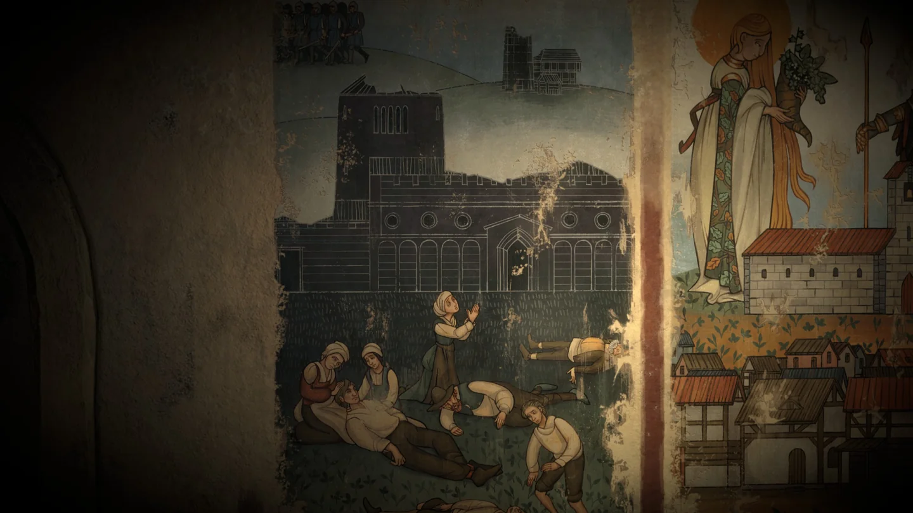

 3막에 이르면 마을은 많은 것을 잃은 뒤다. 그럼에도 남은 사람들은 살아가야 한다. 2막에서 짓고 있던 시청이 완공되고, 마을은 그 벽에 지난 역사를 그리기로 한다. 벽화를 맡기로 했던 인쇄업자 클라우스는 보랏빛 쪽지를 받은 뒤 습격을 당하고, 다행히 목숨을 건진 그를 대신해 딸 막달레나가 자신이 그리겠다고 나선다.

 18년 전의 일은 마을 사람 모두가 함께 겪은 일이지만, 남은 이들이 그 일을 기억하고 싶어 하는 방식은 저마다 다르다. 어떤 이들은 그 일을 아예 없었던 일처럼 여기며 잊고 싶어 하고, 어떤 이들은 부끄러운 일을 좋게 고쳐 남기고 싶어 한다. 반대로 그날을 잊어서는 안 된다고 말하는 사람도 있다.

 잊을 것인가, 좋게 고쳐 그릴 것인가, 있는 그대로 남길 것인가. 벽화에 무엇을 그릴지는 플레이어의 몫이다. 25년 동안 마을에 쌓인 일들 가운데에는 보랏빛 필체의 진실도 있다. 그 진실을 사람들에게 알릴지 말지에 따라, 에필로그에서 보이는 마지막 벽화도 달라진다.

 1, 2막에서 누구에게 책임을 물을지가 플레이어가 무엇을 중요하게 생각하는지를 드러냈다면, 3막의 벽화는 플레이어가 어떤 기억을 남겨야 한다고 생각하는지를 드러낸다.

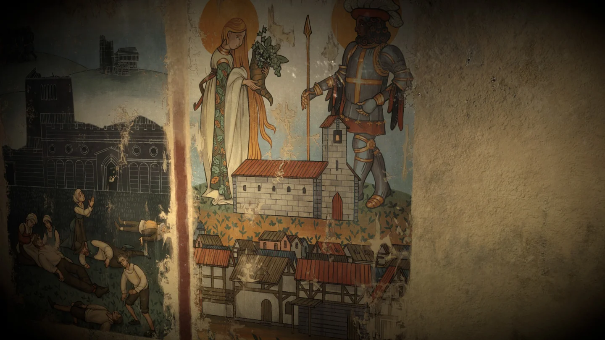

## 플레이 방식

 플레이 방식은 단순하다. 마을과 수도원을 오가며 사람들을 만나고, 대화 선택지를 골라 이야기를 나눈다. 사건의 단서도 대부분 그 이야기 속에 있다. 그래서 누구를 먼저 찾아가 무엇을 물어볼지, 어느 집 식탁에 앉을지를 고르는 것이 그대로 사건을 조사하는 과정이 된다.

### 대화

 게임은 도입부의 대화에서 안드레아스가 **어떤 사람인지**부터 정하게 한다. 대학에서 무엇을 공부했는지, 어떤 분야에 관심이 있는지, 어떤 태도로 삶을 대하는 사람인지를 플레이어가 직접 고르는데, 이렇게 정한 배경은 단순한 설정으로 끝나지 않고 이후의 대화 선택지를 바꾼다. 같은 사람을 만나도 안드레아스가 어떤 사람이냐에 따라 꺼낼 수 있는 이야기가 다르고, 그만큼 얻을 수 있는 단서도, 상대를 설득할 수 있는 길도 달라진다.

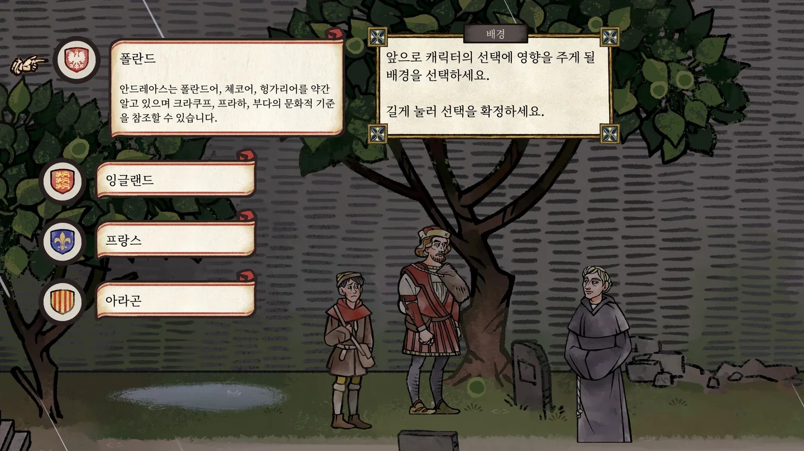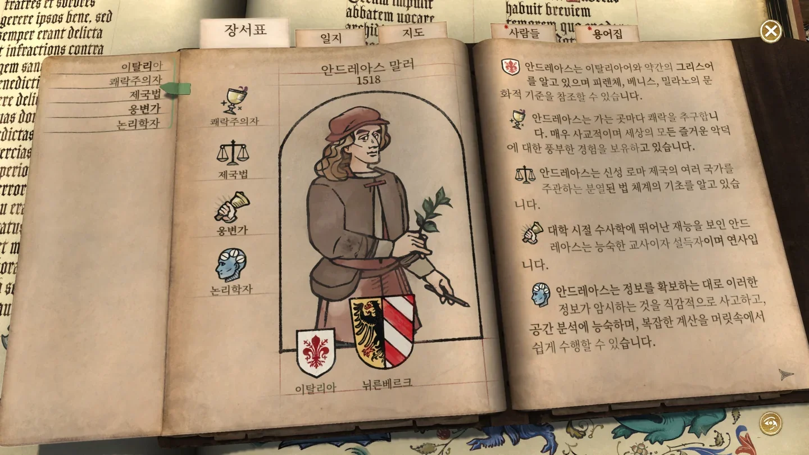

 **다만 배경 덕분에 떠오른 선택지가 늘 더 나은 대답은 아니다.** 이탈리아에서 지냈다면 이탈리아어로 말을 걸 수 있고, 대학에서 배운 지식을 꺼내 보일 수도 있다. 하지만 그런 대답은 상대에게 잘난 체하는 사람처럼 비치기 쉽고, 대화가 오히려 나쁜 쪽으로 흐르기도 한다. 소여는 선택지가 열렸다고 해서 그것을 고르는 게 좋은 생각은 아니라고 말하며, 플레이어가 무심코 고르지 말고 무엇을 고를지 생각해 보기를 바란다고 덧붙인다.[^thegamer]

 곤란한 선택 앞에서는 가끔 선택지 아래에 구름 모양의 말풍선이 하나 더 붙는다. 이 말풍선을 고르면 안드레아스 안의 여러 목소리가 저마다 다른 대답을 권하고, 그 대답이 어떤 결과로 이어질지도 귀띔해 준다. 플레이어에게는 고르기 전에 한 번 더 따져 볼 수 있는 일종의 힌트다.

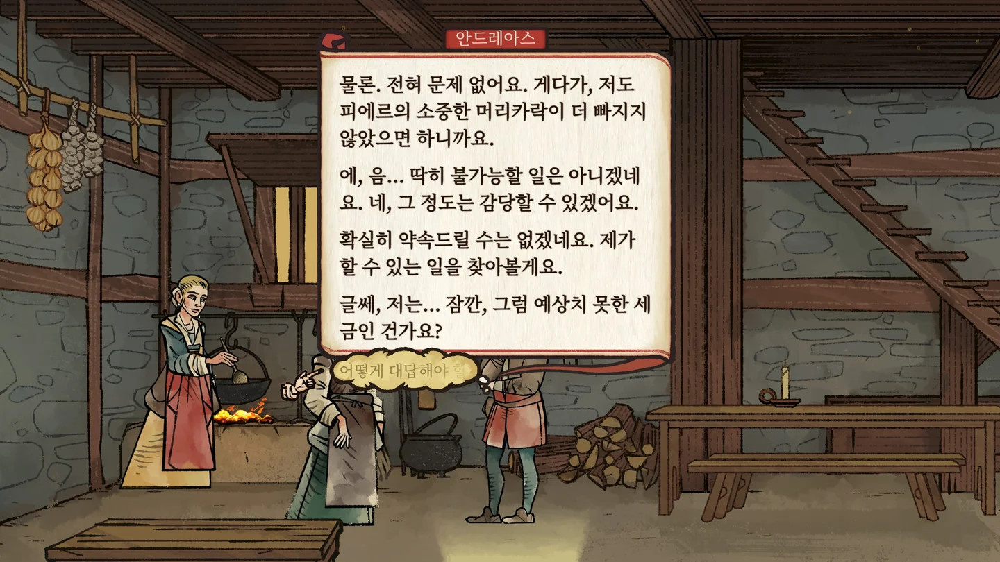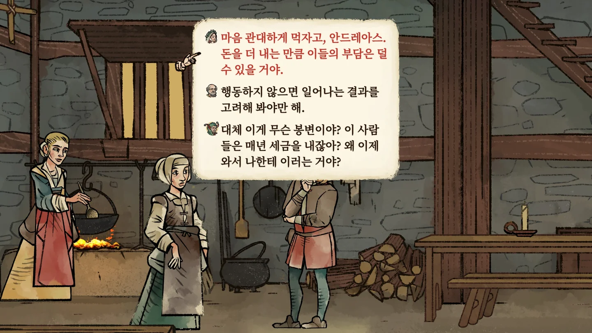

 대화 중에는 이 배경과 그동안의 선택을 바탕으로 상대를 설득하는 장면도 있다. 고른 대답 가운데 일부에는 "이 선택을 기억합니다"라는 표시가 붙는데, 이렇게 기억해 둔 대답은 설득하는 자리에서 다시 나온다. 설득을 시도하면 그동안 플레이어가 했던 행동과 대화 가운데 무엇이 힘이 되고 무엇이 발목을 잡는지가 함께 표시된다. 남작 앞에서 별생각 없이 고개를 끄덕였던 일이, 나중에 그를 설득할 때 감점으로 돌아오기도 한다. 다만 어떤 선택이 통할지 미리 가늠하기는 쉽지 않다.

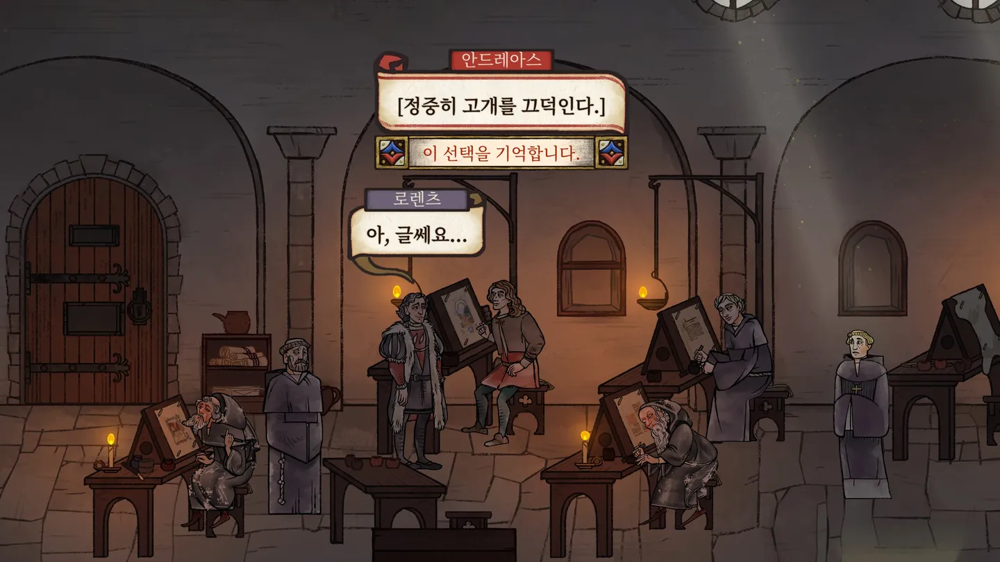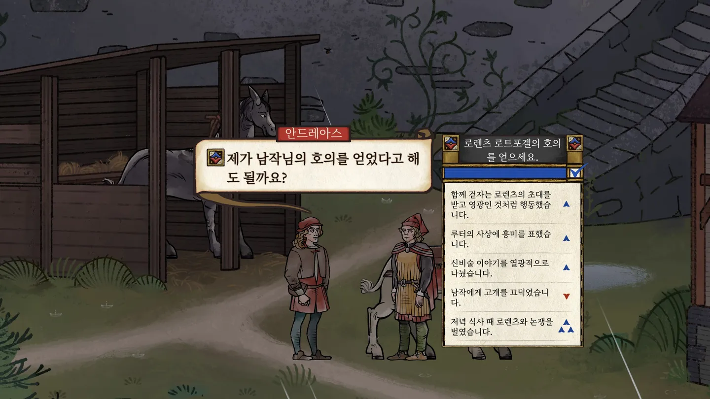

#### 미니 게임

 대화 사이사이에는 마을의 일상을 손으로 겪게 하는 미니 게임들이 놓여 있다. 식사 자리에서는 차려진 음식을 하나씩 집어 먹으며 이야기를 나누고, 마을 여인들 틈에 끼어 그들의 손놀림에 맞춰 실을 잣기도 하며, 3막의 크리스마스 잔치를 앞두고는 모두에게 돌아갈 만큼 쿠키를 찍어 낸다. 어느 것도 어렵지는 않다.

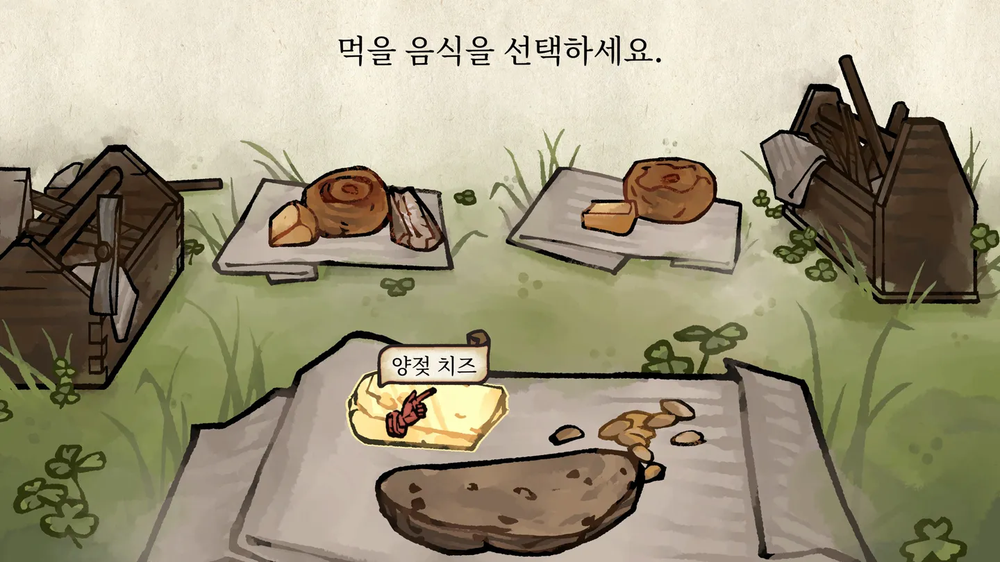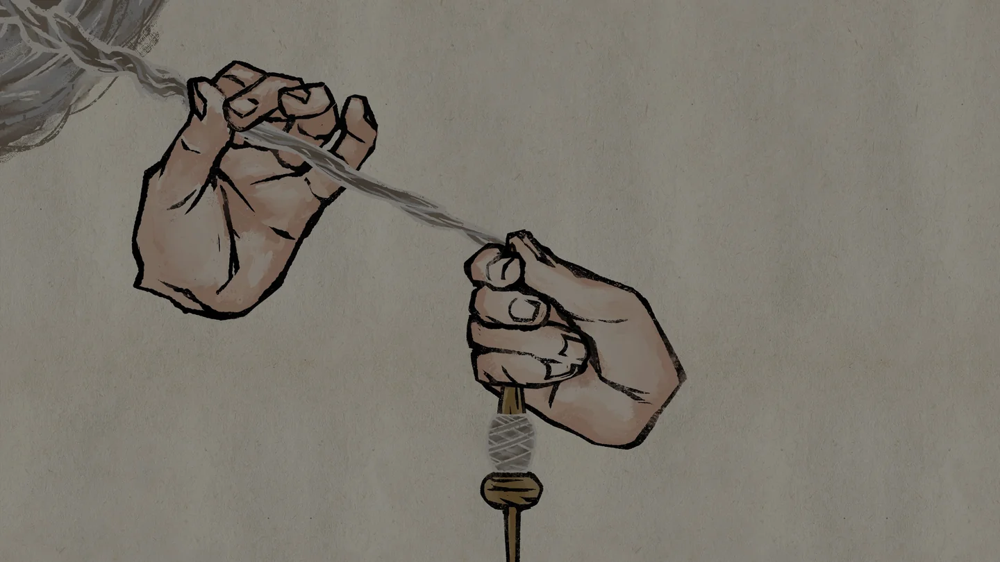

 어렵지 않은 대신, 이 시간에는 손보다 귀가 바쁘다. 실을 잣는 여인들은 손을 놀리면서 누가 마을을 떠났는지, 누구네 집에 무슨 사정이 있는지를 주고받는다. 식탁에서는 감사 기도로 시작한 식사가 어느새 수도원에 내야 할 세금과 빠듯한 살림 이야기로 흘러간다. 음식을 하나 집어 들 때마다 이야기도 한 마디씩 이어진다.

 **이 대화들은 대부분 사건의 단서가 되지 않는다.** 그런데도 게임은 플레이어를 꼬박꼬박 식탁에 앉힌다. 식사는 하루에 반드시 거쳐야 하는 별도의 시간이고, 그동안에는 다른 일을 할 수 없다. 대신 마을 사람들이 무엇으로 먹고살고, 무엇을 두려워하고, 서로를 어떻게 생각하는지는 거의 이런 자리에서 들려온다.

 이 시간들이 있기에 플레이어의 선택이 무거워진다. 게임은 마을 사람들을 범인 후보로 만나게 하기 전에, 먼저 **같은 식탁에 앉고 같은 일을 거드는 이웃**으로 만나게 한다. 그래서 누군가를 지목할 때 떠오르는 것은 단서만이 아니다. 그 사람과 함께 앉았던 식탁도 같이 떠오른다.

### 시간

 펜티먼트에도 **시간 제한**이 있다. 범인을 지목해야 하는 때까지 남은 날짜가 정해져 있고, 하루는 새벽 기도부터 밤 기도까지 수도원의 기도 시간을 따라 몇 개의 시간대로 나뉜다. 시간이 드는 대화나 행동에는 "시간이 흐릅니다"라고 여러 방법으로 알려 준다.

 게임은 어떤 행동에 시간이 든다는 것, 그리고 그 행동을 하면 다른 무언가를 놓칠 수 있다는 것까지는 알려 준다. 기록을 찾으러 계단을 오르면 시간이 걸린다고, 지금 돌아가지 않으면 내일 아침을 허비한다고 인물들이 직접 말해 주기도 한다. 하지만 남은 날짜가 며칠인지, 그 일에 시간이 얼마나 드는지는 끝내 알려 주지 않는다. 그러니 두 가지 행동을 놓고 어느 쪽이 시간이 덜 드는지 따져 볼 방법이 없다.

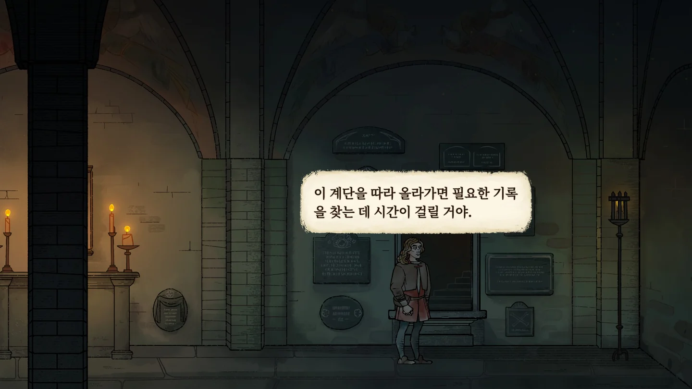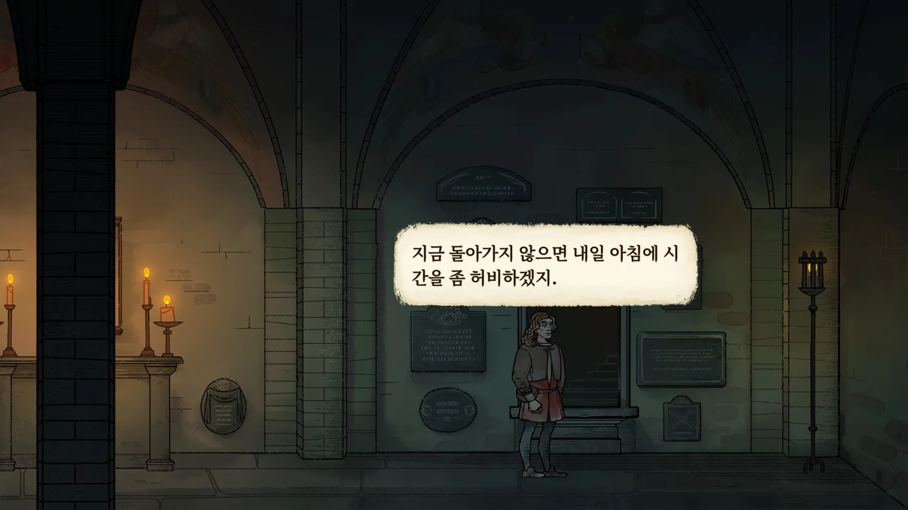

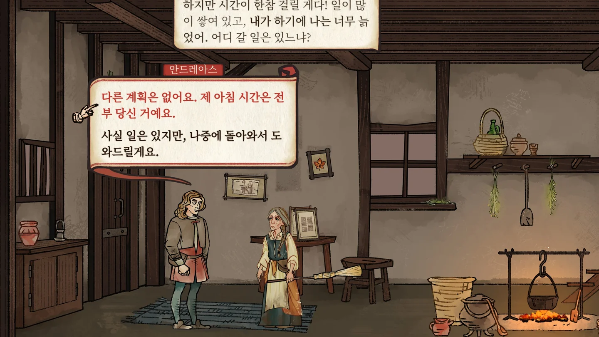

 그래서 플레이어는 미리 계산하며 움직일 수 없다. 그저 안드레아스가 되어 그때그때 마음이 가는 쪽을 고르고, 나중에야 그때 그 사람을 찾아가 볼 걸 하고 곱씹게 된다.

 물론 대가도 있다. 무언가를 놓친다는 것은 알아도, 무엇을 놓치는지는 모른 채 포기하게 된다.

#### 종소리와 시계

 시간이 흐를 때마다 나오는 짧은 컷신도 인상적이다. 1, 2막에서는 아침 기도, 일하기, 정오 기도, 먹기, 오후 3시 기도처럼 수도원의 기도 시간에 맞춰 하루가 나뉜다. 그런데 3막에서 화자가 바뀌자 이 컷신이 시계로 바뀐다.

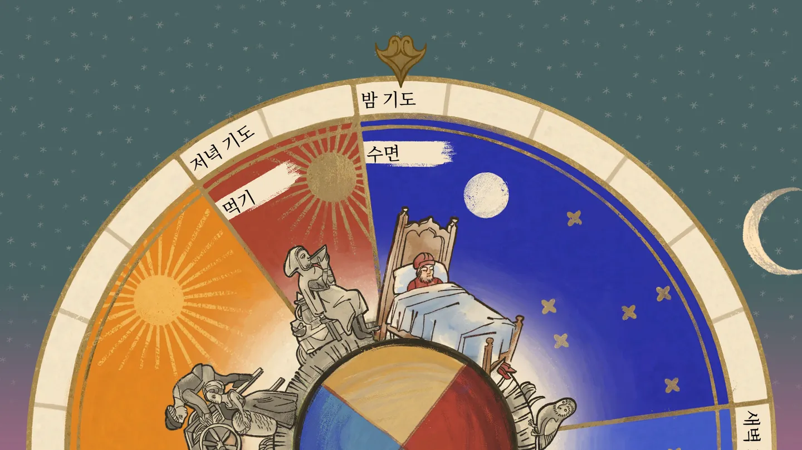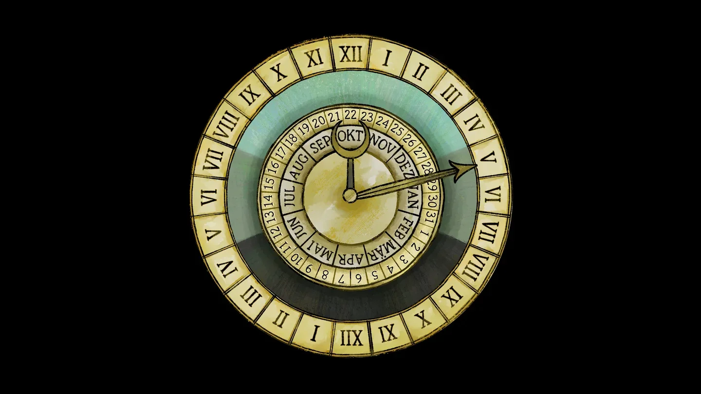

 기계식 시계는 1543년에 새로 등장한 물건이 아니다. 달라진 것은 **하루를 재는 기준**이다. 1, 2막의 안드레아스는 수도원 기록실에서 일하며 수도원의 종소리에 맞춰 하루를 보냈다. 그 수도원은 2막이 끝나며 버려졌다. 3막의 화자인 막달레나는 마을의 인쇄소에서 자랐고, 시계에 맞춰 하루를 보낸다.

 역사학자 자크 르 고프(Jacques Le Goff)는 중세 말에 일어난 이런 변화를 **교회의 시간**과 **상인의 시간**이라는 말로 설명한 바 있다.[^legoff] 교회가 종을 울려 알려 주던 하루가, 마을과 도시의 시계가 재는 하루로 넘어가는 변화다. 유럽이 몇 세기에 걸쳐 지나온 그 변화가, 타싱의 하루에도 그대로 비친다.

### 판결

 범인을 지목하는 것은 플레이어지만, 판결을 내리는 사람은 따로 있다. 1막에서 그 사람은 부주교다. 개발진은 그를 플레이어의 주장을 받아들일지 판정하는 장치로 만들었고, 그의 선입견 때문에 다른 용의자보다 더 쉽게 받아들여지는 용의자가 있다.[^gamedev] 플레이어는 아예 판결에 끼어들지 않는 쪽을 고를 수도 있다.

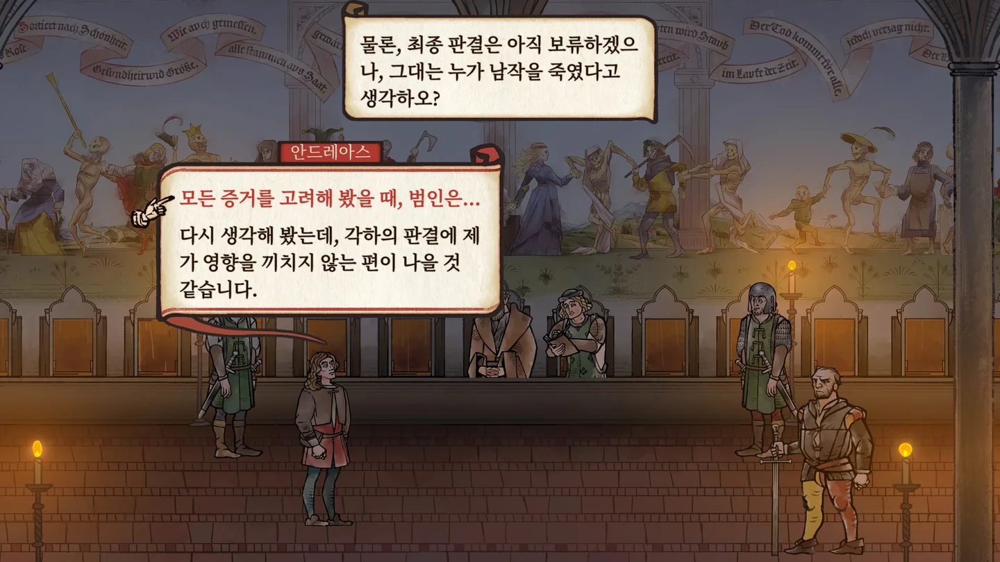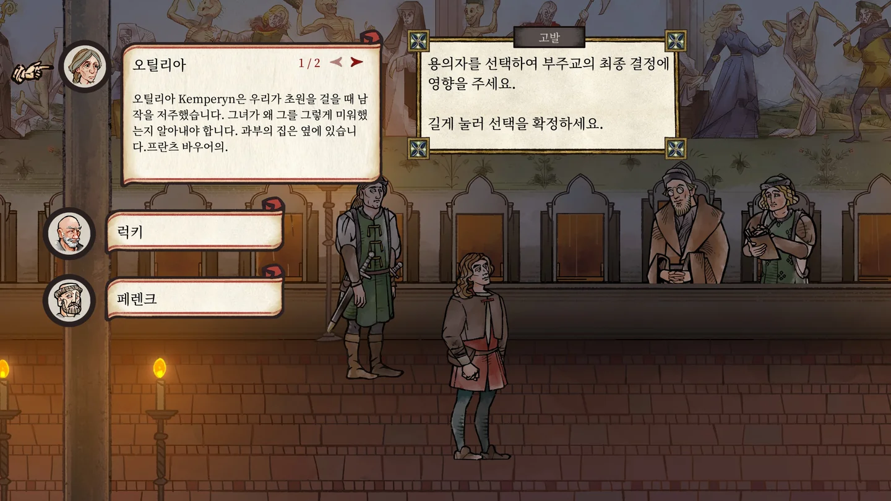

 2막에서는 판관이 바뀐다. 수도사들을 가둔 성난 농민들 앞에서, 안드레아스는 오토를 죽인 사람이 수도원장이 아니라는 것을 밝혀야 한다. 수도원을 향한 분노로 가득한 그들 앞에서는, 수도원 사람을 범인으로 내세우는 주장이 더 쉽게 받아들여질지도 모른다.

 1막이든 2막이든, 판결을 앞두고 안드레아스는 그동안 알아낸 것을 하나씩 늘어놓는다. 누가 피해자와 다퉜고, 누가 그를 미워할 이유가 있었는지. 그런데 알아낸 것을 전부 말할 필요는 없다. **어떤 증인에게서 들은 이야기는, 그 선택지를 고르지 않고 넘어가면 끝내 판관에게 전해지지 않는다.** 그래서 플레이어는 범인의 이름과 함께, 판관이 무엇을 듣고 판결할지까지 고르게 된다. 누군가를 감싸려고 어떤 이야기를 덮어 둘 수도 있고, 누군가를 몰아가려고 어떤 이야기만 골라 꺼낼 수도 있다.

 그리고 어느 쪽이든, 한 번 내려진 판결은 되돌릴 수 없다.

### 저장

 되돌릴 수 없는 것은 판결만이 아니다. 펜티먼트는 세이브 파일을 하나만 두고, 그마저 자동으로만 저장한다. 대화에서 고른 대답 하나, 시간을 어디에 썼는지, 누구를 범인으로 지목했는지까지, 한 번 고른 것은 다시 고를 수 없다.

 그만큼 불편하기도 하다. 선택에 따라 이야기가 갈리는 게임인데도, 다른 갈래를 보려면 이 긴 이야기를 처음부터 다시 해야 한다. 엔딩을 보기까지 10시간 가까이 걸리는 이야기를 갈래마다 다시 해 보기는 쉽지 않다.

 **하지만 이러한 구조는 분명 의도로 읽힌다.** 언제든 다시 고를 수 있다면 선택의 무게는 가벼워지기 마련이고, 앞서 말한 책임의 무게도 이런 장치가 있기에 가능하다.

## 비주얼

 펜티먼트를 이야기하면서 아트를 빼놓을 수는 없다. 중세 필사본 삽화의 화풍을 따르면서도 인물들을 귀엽게 데포르메했고, 그 인물들이 무척 부드럽게 움직인다. 책장 속 삽화가 그대로 걸어 나와 말을 거는 듯하다.

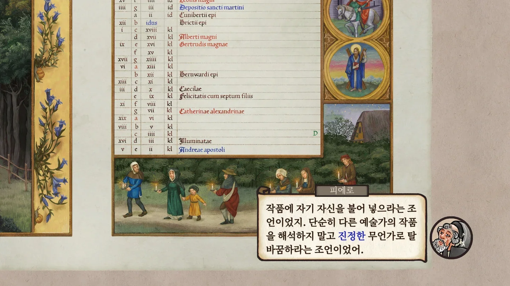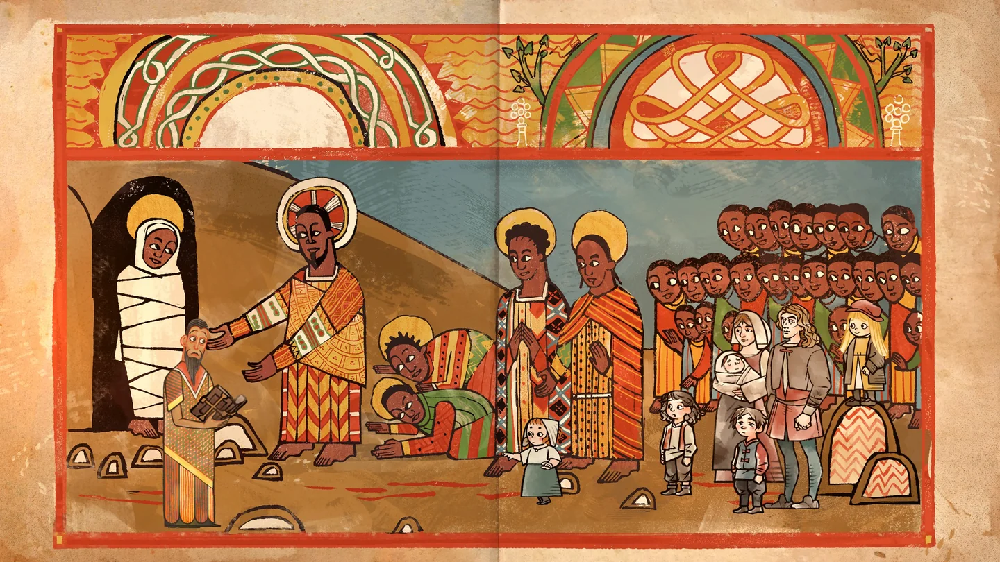

 이 화풍은 대사에도 이어진다. 대사는 말풍선 안에 손글씨나 활자로 적히고, 안드레아스가 보기에 상대가 어떤 신분이고 얼마나 배운 사람인지에 따라 글씨체가 다르다. 수도사의 말은 필사본에 쓰던 블랙레터로, 인쇄업자의 말은 인쇄 활자로, 글을 모르는 농민의 말은 투박하고 삐뚤빼뚤한 손글씨로 쓰인다.

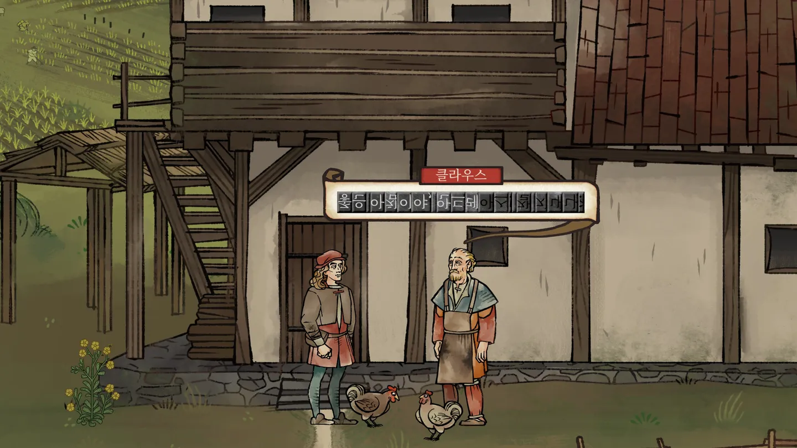

 글씨가 써지는 과정도 그대로 보인다. 글자는 한 획씩 그어지고, 잘못 쓴 글자는 긁어낸 뒤 다시 쓴다. 인물이 흥분하면 잉크가 튀기도 한다. 말풍선 하나하나가 누군가 방금 손으로 써 내려간 글처럼 보인다.

 글씨체는 대화 도중에 바뀌기도 한다. 아트 디렉터 해나 케네디(Hannah Kennedy)에 따르면, 글씨체는 안드레아스가 그 사람을 어떻게 보는지에 따라 정해지고, 그 생각이 바뀌면 글씨체도 따라 바뀐다.[^pcgamesn] 남작이 대학에서 공부했다는 이야기를 꺼내자, 그의 말도 말풍선 안에서 다시 쓰인다. 영문판이라면 플레이어는 글씨가 바뀌는 것을 보고, 안드레아스가 그 사람을 다시 보게 되었다는 것을 알아챌 수 있다. 다만 한글 서체는 영문판만큼 다양하지 않아서, 글씨가 다시 쓰여도 무엇이 달라졌는지 알아보기 어렵다. 그래서 플레이하는 동안에는 이런 부분을 충분히 눈치채지 못했는데, 그 점이 아쉽다.

 메뉴와 일지도 책의 모양을 하고 있어서, 펼치면 그동안 만난 사람들과 지도, 낯선 낱말들이 장마다 정리되어 있다. 게임을 잠시 멈춘 동안에도 안드레아스의 책 속에 머물게 된다. 메뉴 하나, 장 하나까지 이 테마를 놓치지 않은 꼼꼼함이 화면을 끝까지 즐겁게 만든다.

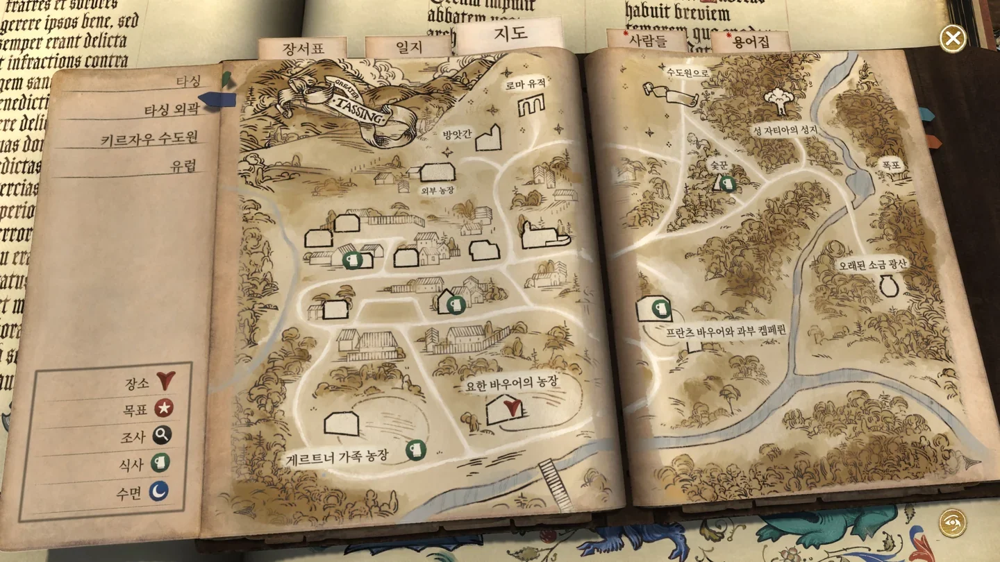

## 정리

 **펜티먼트**(Pentiment)는 **덧칠한 그림 아래에 먼저 그렸던 그림이 세월이 지나 비쳐 보이는 현상**을 가리킨다. 타싱에도 그런 층이 있다. 마을 들판에는 로마 시대의 수도교가 아직 서 있고, 마을 사람들은 그리스도교의 축일에도 그보다 오래된 풍습을 따른다. 수백 년 동안 새로운 그림으로 덧칠되어 온 마을이지만, 그 오래된 밑그림은 이렇게 풍경과 풍습 사이로 비쳐 나온다.

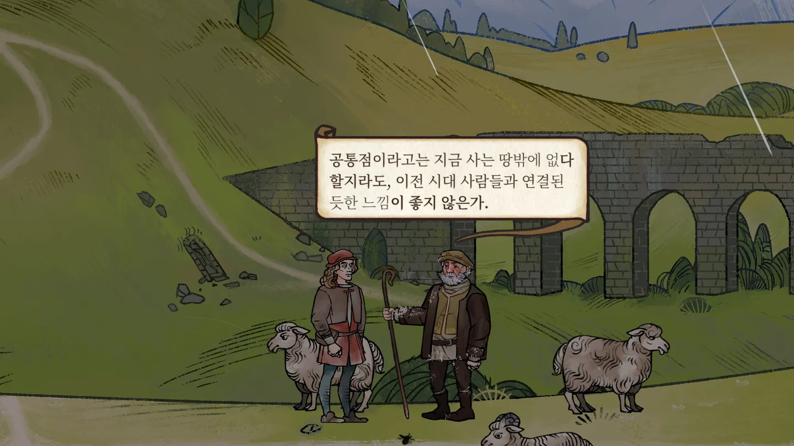

 디렉터 조시 소여는 대학에서 역사를 전공했고, 학부 시절 지도교수였던 역사학자의 자문을 받아 이 게임을 만들었다. 그래서인지 펜티먼트에는 역사를 공부한 사람이 기록을 대하는 태도가 묻어난다. 전통적인 역사 서술은 이긴 쪽에서 성공의 원인을, 진 쪽에서 실패의 원인을 찾아 부각했고, 그와 반대되는 사실은 가볍게 다뤘다. 그래서 사료 비판에 익숙한 오늘날의 역사학자들은 기록을 그대로 믿지 않고 의심한다.[^inmun360] 펜티먼트는 그런 눈으로 그 서술에서 밀려난 이야기들을 골라 들려준다. 농민들이 털어놓는 세금과 농사 걱정, 오래된 풍습과 미신, 이웃 사이에 도는 소문과 아이들의 놀이, 범인으로 몰린 이들의 사정까지. 어느 연대기에도 적히지 않았을 이야기들이다.

 이 이야기들을 들으며 타싱을 돌아다니다 보면, 어느새 그것을 기록하는 자리에 서게 된다.

 장미의 이름은 이런 문장으로 끝난다.

> Stat rosa pristina nomine, nomina nuda tenemus.\
> (지난날의 장미는 이제 그 이름뿐, 우리에게 남은 것은 그 덧없는 이름뿐)[^rose]

 소설 속 수도원은 불타 없어지고, 늙은 아드소에게는 타다 남은 책의 조각들뿐이다. 장미는 사라지고 그 이름만 남는다. 이름만으로는 그 이름으로 불리던 것이 어떤 모습이었는지 알 수 없다. 아드소는 이 기록을 누구를 위해 남기는지도 모르겠다며 펜을 놓는다.

 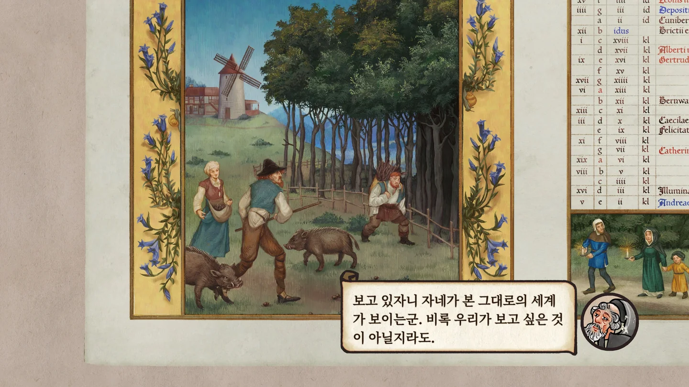

 **펜티먼트에서는 플레이어가 그 펜을 쥔다.** 누가 범인으로 기억될지, 마을의 지난 일이 시청 벽에 어떤 모습으로 그려질지가 모두 그 손에 달려 있다. 피에로 수사는 안드레아스의 그림을 보며, 그가 본 그대로의 세계가 보인다고 말한다. 그것이 사람들이 보고 싶어 하는 모습이 아니더라도. 본 그대로 적을지, 보고 싶은 모습으로 고쳐 그릴지도 플레이어가 고른다. 게임은 그 선택이 옳았는지 끝내 알려 주지 않는다. 기록하는 사람의 자리에 직접 앉아 보게 하는 것, 게임이라는 형식이기에 가능한 일이다.

 펜티먼트는 친절한 추리 게임은 아니다. 단서는 흐릿하고, 시간은 늘 모자라며, 한 번 고른 것은 되돌릴 수 없다. 정답도 끝내 알려 주지 않으니, 추리물을 기대했다면 답답할 수 있다. 하지만 그 불친절함 덕분에, 누구를 범인으로 세우고 무엇을 기억으로 남길지는 온전히 고른 사람의 몫이 된다. 마지막 장을 덮고 나면, 타싱에는 사라진 이들의 빈자리와 벽화들이 남는다. 엔딩을 본 지금도 마지막 벽화에 무엇을 그렸어야 했는지는 잘 모르겠다. 그 망설임이 아직 가시지 않는다.

> | | | |
> |:--|:--|:--|
> | **아트** | ★★★★★(10점) | 책장 속 삽화가 걸어 나와 말을 건다 |
> | **스토리** | ★★★★(8점) | 정답 없는 추리, 정해진 비극 |
> | **연출** | ★★★★(8점) | 글씨 한 획, 잉크 한 방울까지, 다만 한글 서체는 아쉽다 |
> | **캐릭터** | ★★★★☆(9점) | 평범한 사람들이 이렇게 입체적일 줄이야 |
> | **세계관/설정** | ★★★★★(10점) | 16세기 바이에른으로 떠나는 역사 수업 |
> | **선택·대화** | ★★★★☆(9점) | 고른 대답을 게임이 기억한다, 다만 아는 척은 금물 |
> | **시간 시스템** | ★★★★(8점) | 계산 대신 마음 가는 대로, 놓친 것은 끝내 모른 채 |
> | **미니 게임** | ★★★★☆(9점) | 손보다 귀가 바쁜 |
> | **엔딩** | ★★★★(8점) | 바꿀 수 없는 비극, 그래서 더 망설여지는 벽화 |
> | **편의성** | ★★★☆(7점) | 불편함까지 의도라면 할 말은 없다 |
> | | | |
> | **총점** | ★★★★(86/100) | *플레이어가 써 내려가는 장미의 이름* |

[^rose]: 움베르토 에코, <<장미의 이름>>, 이윤기 옮김, 열린책들.
[^official-story]: [스팀 상점 페이지](https://store.steampowered.com/app/1205520/Pentiment/) 한국어 소개
[^thegamer]: Andy Kelly, ["Interview: Obsidian's Josh Sawyer On Pentiment, A Historical Murder Mystery Where Your Choices Echo Through The Ages"](https://www.thegamer.com/interview-obsidian-josh-sawyer-pentiment/), TheGamer, 2022-06-27.
[^gamedev]: Bryant Francis, ["Making Pentiment's most macabre murder mysteries"](https://www.gamedeveloper.com/design/making-pentiment-s-most-macabre-murder-mysteries), Game Developer, 2023-01-04.
[^inmun360]: 윤진석, ["'역사는 승자의 기록'이란 말의 빛과 그림자"](https://inmun360.culture.go.kr/content/357.do?mode=view&cid=2367758), 인문360, 2021-03-10.
[^pcgamesn]: Ken Allsop, ["How Pentiment's art and mini-games help tell its 25-year story"](https://www.pcgamesn.com/pentiment/art-fonts-story), PCGamesN, 2022-11-13.
[^legoff]: 자크 르 고프(Jacques Le Goff), 「중세의 교회의 시간과 상인의 시간」(Au Moyen Âge : temps de l'Église et temps du marchand), *Annales*, 1960.